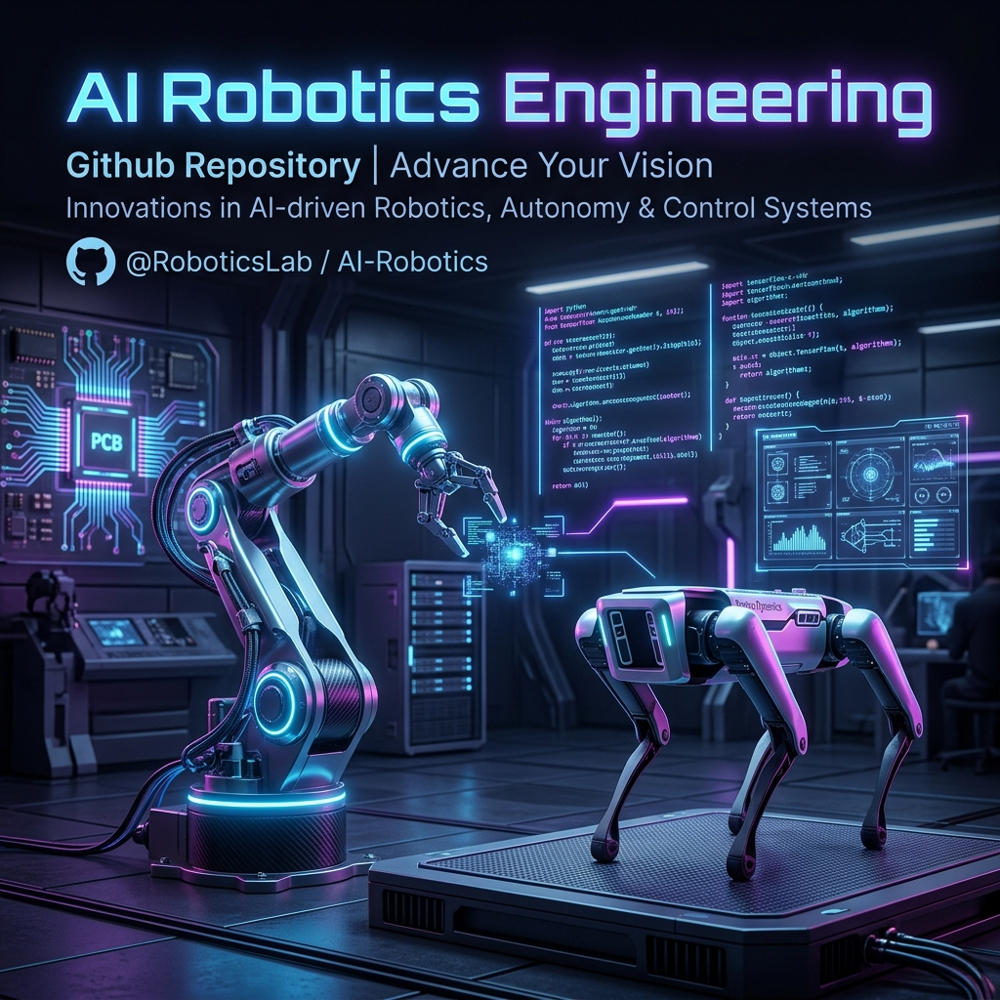

<div align="center">


```text
██████╗ ██╗  ██╗██╗   ██╗███████╗██╗ ██████╗ █████╗ ██╗
██╔══██╗██║  ██║╚██╗ ██╔╝██╔════╝██║██╔════╝██╔══██╗██║
██████╔╝███████║ ╚████╔╝ ███████╗██║██║     ███████║██║
██╔═══╝ ██╔══██║  ╚██╔╝  ╚════██║██║██║     ██╔══██║██║
██║     ██║  ██║   ██║   ███████║██║╚██████╗██║  ██║███████╗
╚═╝     ╚═╝  ╚═╝   ╚═╝   ╚══════╝╚═╝ ╚═════╝╚═╝  ╚═╝╚══════╝

██╗███╗   ██╗████████╗███████╗██╗     ██╗     ██╗ ██████╗ ███████╗███╗   ██╗ ██████╗███████╗
██║████╗  ██║╚══██╔══╝██╔════╝██║     ██║     ██║██╔════╝ ██╔════╝████╗  ██║██╔════╝██╔════╝
██║██╔██╗ ██║   ██║   █████╗  ██║     ██║     ██║██║  ███╗█████╗  ██╔██╗ ██║██║     █████╗
██║██║╚██╗██║   ██║   ██╔══╝  ██║     ██║     ██║██║   ██║██╔══╝  ██║╚██╗██║██║     ██╔══╝
██║██║ ╚████║   ██║   ███████╗███████╗███████╗██║╚██████╔╝███████╗██║ ╚████║╚██████╗███████╗
╚═╝╚═╝  ╚═══╝   ╚═╝   ╚══════╝╚══════╝╚══════╝╚═╝ ╚═════╝ ╚══════╝╚═╝  ╚═══╝ ╚═════╝╚══════╝
```

# AI Robotics Engineering

### The Ultimate Compendium for Electronics Engineering, Robotics & Physical AI

[](https://awesome.re)
[](CONTRIBUTING.md)
[](LICENSE)
[](https://github.com/aredwan-xyz/ai-robotics-engineering/stargazers)
[](https://github.com/aredwan-xyz/ai-robotics-engineering)

> *"The next wave of AI is not in the cloud — it lives in the real world, in metal and silicon, moving, sensing, and adapting."*

**This repository is the hardware engineer's bible.** Whether you're just discovering resistors or designing full-stack autonomous robots with onboard ML inference, everything you need lives here — curated, organized, and battle-tested.

[**Start Here**](#-start-here) • [**Roadmaps**](#-learning-roadmaps) • [**Electronics**](#-electronics-engineering) • [**Robotics**](#-robotics) • [**Physical AI**](#-physical-ai--embodied-intelligence) • [**Projects**](#-project-ideas) • [**Tools**](#-tools--software) • [**Community**](#-community)

</div>

---

## Why This Exists

Most "awesome" lists are link graveyards. This one is different:

- Every resource is **tested and verified** — no dead links, no fluff
- Resources are **rated by difficulty** (⬜ Beginner / 🟦 Intermediate / 🟥 Advanced)
- Includes **actual code, formulas, and diagrams** — not just links
- Covers the full stack: **atoms → bits → behavior**
- Built by engineers, for engineers

**If this helped you**, please ⭐ star it — it helps others find it too.

---

## Why C++? (The Language of Hardware)

You might notice this repository is heavily dominated by C and C++. While Python rules the AI cloud, C++ is the undisputed king of the physical engineering world:

1. **Deterministic Timing**: Languages like Python or JavaScript are "garbage collected," meaning they occasionally pause execution to clean up memory. If a drone flight controller pauses for 10ms, the drone crashes. C++ gives you manual, deterministic control over memory.
2. **Resource Constraints**: Microcontrollers often have less than 500KB of RAM. C++ allows for bare-metal performance and direct register manipulation with zero overhead.
3. **The Robotics Standard**: ROS 2 (Robot Operating System) is written in C++ for maximum performance.

*Note: Python is still heavily used in the "Physical AI" sections for training reinforcement learning policies and neural networks (PyTorch/Isaac Lab) before they are deployed to the C++ hardware.*

---

## Table of Contents

- [Start Here](#-start-here)
- [Learning Roadmaps](#-learning-roadmaps)
- [Electronics Engineering](#-electronics-engineering)
  - [Fundamentals](#fundamentals)
  - [Circuit Design](#circuit-design)
  - [PCB Design](#pcb-design)
  - [Power Electronics](#power-electronics)
  - [Signal Processing](#signal-processing)
  - [RF & Wireless](#rf--wireless)
- [Microcontrollers & Embedded Systems](#-microcontrollers--embedded-systems)
  - [Arduino Ecosystem](#arduino-ecosystem)
  - [ESP32 & ESP8266](#esp32--esp8266)
  - [STM32 & ARM Cortex](#stm32--arm-cortex)
  - [RISC-V](#risc-v)
  - [Raspberry Pi & SBCs](#raspberry-pi--sbcs)
- [Robotics](#-robotics)
  - [Fundamentals & Theory](#fundamentals--theory)
  - [Kinematics & Dynamics](#kinematics--dynamics)
  - [Motion Planning](#motion-planning)
  - [Robot Operating System (ROS)](#robot-operating-system-ros)
  - [Actuators & Motors](#actuators--motors)
  - [Sensors & Perception](#sensors--perception)
  - [Manipulation](#manipulation)
  - [Mobile Robotics](#mobile-robotics)
  - [Aerial Robotics (Drones)](#aerial-robotics-drones)
  - [Humanoid Robotics](#humanoid-robotics)
- [Physical AI & Embodied Intelligence](#-physical-ai--embodied-intelligence)
  - [Edge AI & TinyML](#edge-ai--tinyml)
  - [Reinforcement Learning for Robotics](#reinforcement-learning-for-robotics)
  - [Sim-to-Real Transfer](#sim-to-real-transfer)
  - [Foundation Models for Robotics](#foundation-models-for-robotics)
  - [Neuromorphic Computing](#neuromorphic-computing)
- [Simulators & Digital Twins](#-simulators--digital-twins)
- [Protocols & Communication](#-protocols--communication)
- [Tools & Software](#-tools--software)
- [Hardware Platforms & Kits](#-hardware-platforms--kits)
- [Project Ideas](#-project-ideas)
- [Open Source Hardware](#-open-source-hardware)
- [Research & Papers](#-research--papers)
- [Competitions & Challenges](#-competitions--challenges)
- [Community](#-community)
- [Jobs & Careers](#-jobs--careers)
- [Cheatsheets & Quick References](#-cheatsheets--quick-references)
- [Contributing](#-contributing)

---

## 🚀 Start Here

> Don't know where to begin? Start here. Three paths depending on your goal.

### Path A: "I want to build electronics" → [Electronics Roadmap](roadmaps/electronics-engineer.md)
### Path B: "I want to build robots" → [Robotics Roadmap](roadmaps/robotics-engineer.md)
### Path C: "I want AI that exists in the real world" → [Physical AI Roadmap](roadmaps/physical-ai.md)

**Minimum viable toolkit to get started today:**

| Item | Purpose | Cost |
|------|---------|------|
| Arduino Uno / ESP32 | First microcontroller | $5–$25 |
| Breadboard + jumper wires | Prototyping | $5 |
| Multimeter (e.g. UNI-T UT61E) | Measurements | $30–$50 |
| KiCad (free) | PCB design | Free |
| VS Code + PlatformIO | Embedded IDE | Free |
| Wokwi / Falstad | Circuit simulation | Free |

---

## 🗺 Learning Roadmaps

> Visual, step-by-step paths from zero to expert. Each roadmap is a full document.

| Roadmap | Description | Time Estimate |
|---------|-------------|---------------|
| [Electronics Engineer](roadmaps/electronics-engineer.md) | From Ohm's Law to PCB design and analog IC design | 6–18 months |
| [Embedded Systems Engineer](roadmaps/embedded-systems.md) | From Arduino to bare-metal ARM, RTOS, and drivers | 6–12 months |
| [Robotics Engineer](roadmaps/robotics-engineer.md) | From kinematics to full autonomous robot systems | 12–24 months |
| [Physical AI Engineer](roadmaps/physical-ai.md) | From TinyML to sim-to-real RL and foundation models | 12–24 months |
| [Drone / UAV Engineer](roadmaps/drone-engineer.md) | Flight dynamics, flight controllers, autonomy | 6–18 months |

---

## ⚡ Electronics Engineering

### Fundamentals

**Essential concepts you must master:**

```
Ohm's Law:          V = I × R
Power:              P = V × I = I²R = V²/R
Kirchhoff's Laws:   ΣI = 0 (KCL), ΣV = 0 (KVL)
Capacitor:          Q = CV,  I = C × dV/dt
Inductor:           V = L × dI/dt
RC time constant:   τ = RC
Resonance:          f₀ = 1 / (2π√LC)
Decibels:           dB = 20 × log₁₀(V₂/V₁)
```

**Books** ⬜
- [The Art of Electronics](https://artofelectronics.net/) — Horowitz & Hill. **The** definitive text. Read it cover to cover.
- [Practical Electronics for Inventors](https://www.mhprofessional.com/) — Scherz & Monk. More accessible intro.
- [Make: Electronics](https://www.makershed.com/) — Charles Platt. Best starting point for absolute beginners.
- [Electronic Devices and Circuit Theory](https://www.pearson.com/) — Boylestad. Classic textbook for theory.

**Free Online Courses** ⬜
- [MIT 6.002 Circuits and Electronics](https://ocw.mit.edu/courses/6-002-circuits-and-electronics-spring-2007/) — Free MIT course
- [All About Circuits](https://www.allaboutcircuits.com/textbook/) — Comprehensive free textbook
- [Electronics Tutorials](https://www.electronics-tutorials.ws/) — Topic-by-topic reference
- [Khan Academy Electrical Engineering](https://www.khanacademy.org/science/electrical-engineering) — Great for visual learners

**Simulators (use these daily)**
- [Falstad Circuit Simulator](https://falstad.com/circuit/) — Instant, browser-based, animated
- [LTspice](https://www.analog.com/en/design-center/design-tools-and-calculators/ltspice-simulator.html) — Industry-standard SPICE, free from Analog Devices
- [Wokwi](https://wokwi.com/) — Simulate Arduino, ESP32, STM32 in browser
- [EasyEDA](https://easyeda.com/) — Schematic + SPICE + PCB in browser

### Circuit Design

**Analog Circuits**
- Op-Amp configurations: inverting, non-inverting, differential, integrator, differentiator
- Filters: RC, LC, active (Butterworth, Chebyshev, Bessel)
- Oscillators: Colpitts, Hartley, Wien Bridge, 555 timer
- Amplifiers: Class A/B/AB/D, BJT, MOSFET biasing
- Comparators, Schmitt triggers, sample-and-hold

🟦 [Op Amp Applications Handbook — Walt Jung (Analog Devices)](https://www.analog.com/en/education/education-library/op-amp-applications-handbook.html) — Free PDF, industry standard

**Digital Circuits**
- Logic families: TTL, CMOS, LVDS, ECL
- Combinational: adders, multiplexers, decoders, PLAs
- Sequential: flip-flops, registers, counters, FSMs
- Memory: SRAM, DRAM, Flash, EEPROM
- FPGAs: programmable logic fabric, HDL design

🟥 [FPGA Prototyping by VHDL Examples](https://www.fpga4fun.com/) — FPGA4fun: free beginner FPGA projects

**Mixed-Signal**
- ADC architectures: SAR, delta-sigma, flash, pipeline
- DAC types: R-2R, string, segmented
- Anti-aliasing, Nyquist theorem, oversampling
- PLL design and clock distribution
- Layout guidelines for mixed-signal PCBs

### PCB Design

**The PCB Design Workflow:**
```
Schematic → Netlist → Component Placement → Routing → DRC → Gerber Export → Fab
```

**EDA Tools**
| Tool | Best For | Cost |
|------|----------|------|
| [KiCad 8](https://www.kicad.org/) | Open source, professional quality | Free |
| [Altium Designer](https://www.altium.com/) | Industry standard, enterprise | $$$$ |
| [EasyEDA / LCEDA](https://easyeda.com/) | Quick prototypes, JLCPCB integration | Free |
| [Eagle](https://www.autodesk.com/products/eagle/) | Legacy, Autodesk ecosystem | Free/Paid |
| [OrCAD](https://www.orcad.com/) | Professional EE firms | $$$ |
| [Fusion 360 Electronics](https://www.autodesk.com/products/fusion-360/) | Mechanical + PCB co-design | Free/Paid |

**PCB Fabrication Houses**
| Fab | Min Price | Turnaround | Best For |
|-----|-----------|------------|----------|
| [JLCPCB](https://jlcpcb.com/) | $2 / 5 pcs | 24–48h | Prototypes, PCBA |
| [PCBWay](https://www.pcbway.com/) | $5 / 5 pcs | 48–72h | Prototypes, flex |
| [OSH Park](https://oshpark.com/) | ~$5/sq in | 2 weeks | USA, purple boards |
| [Seeed Fusion](https://www.seeedstudio.com/fusion_pcb.html) | $5 / 10 pcs | 72h+ | Prototypes |
| [Advanced Circuits](https://www.4pcb.com/) | $33+ | 24h | USA, fast turns |

**Design Rules Cheatsheet:**
```
Min trace width:   0.1mm (4mil) proto / 0.15mm recommended
Min clearance:     0.1mm (4mil) proto
Via drill:         0.3mm min (JLCPCB)
Via annular ring:  0.15mm min
Impedance control: 50Ω single-ended, 100Ω differential
Decoupling caps:   100nF per IC power pin, as close as possible
Pour copper:       Pour ground planes on all inner layers
```

🟦 [Phil's Lab (YouTube)](https://www.youtube.com/@PhilsLab) — Best KiCad + hardware design channel

🟥 [Saturn PCB Design Toolkit](https://saturnpcb.com/pcb_toolkit/) — Trace width, via current, impedance calculator (free)

### Power Electronics

**DC-DC Converter Types:**
```
Buck (Step-Down):    Vout < Vin,  efficiency > 90%
Boost (Step-Up):     Vout > Vin,  efficiency > 85%
Buck-Boost:          Vout ≷ Vin   (inverting or non-inverting)
SEPIC:               Vout ≷ Vin   (non-inverting)
Flyback:             Isolated, multiple outputs
Full-Bridge:         High power, EV chargers, motor drives
```

**Key ICs:**
- LM2596 / LM2576 — Simple buck converters ⬜
- MP2315 / TPS54360 — Efficient sync buck 🟦
- LT8645S — Ultra-low quiescent buck 🟦
- LM5170 — Bidirectional multi-phase 🟥
- UCC28C44 — Current-mode PWM controller 🟥

**Battery Management:**
- Li-Ion: 4.2V max, 3.0V cutoff, never overcharge
- BMS ICs: BQ24040, MCP73831, TP4056 (be careful with TP4056 — use module with protection)
- Fuel gauges: BQ27441, MAX17048
- [Battery University](https://batteryuniversity.com/) — Comprehensive free resource

### Signal Processing

**Essential DSP Concepts:**
```python
# Discrete Fourier Transform (DFT)
X[k] = Σ x[n] * e^(-j2πkn/N)   for k = 0, 1, ..., N-1

# Sampling theorem (Nyquist)
fs > 2 * f_max

# Common filter design (Python/SciPy)
from scipy import signal
b, a = signal.butter(4, 1000, fs=44100, btype='low')  # 4th order LPF at 1kHz
```

**Libraries & Tools:**
- [GNU Radio](https://www.gnuradio.org/) — SDR signal processing framework
- [NumPy/SciPy](https://scipy.org/) — DSP in Python
- [DSPy](https://github.com/stanfordnlp/dspy) — Not DSP but worth knowing
- [CMSIS-DSP](https://arm-software.github.io/CMSIS-DSP/latest/) — ARM optimized DSP for embedded

### RF & Wireless

**Frequency Bands Quick Reference:**
```
Sub-GHz ISM:  433MHz, 868MHz (EU), 915MHz (US)
2.4GHz ISM:   WiFi, Bluetooth, Zigbee, Thread
5GHz:         WiFi 5/6
UWB:          3.1–10.6GHz  (precision location ±10cm)
LoRa:         433/868/915MHz  (range: 2–15km)
NB-IoT:       Licensed LTE bands
```

**Protocols by Use Case:**
| Protocol | Range | Data Rate | Power | Use Case |
|----------|-------|-----------|-------|----------|
| Bluetooth LE 5.x | 40m–200m | 2Mbps | Very Low | Wearables, proximity |
| WiFi 6 (802.11ax) | 50m | 9.6Gbps | Medium | High-bandwidth IoT |
| LoRa / LoRaWAN | 2–15km | 0.3–50kbps | Ultra Low | Asset tracking, sensors |
| Zigbee / Thread | 10–100m | 250kbps | Low | Smart home mesh |
| UWB | 10–100m | 27Mbps | Low | Precision location |
| NB-IoT / LTE-M | Global | 250kbps | Low | Cellular IoT |
| Z-Wave | 30m | 100kbps | Low | Home automation |

**SDR (Software Defined Radio):**
- [RTL-SDR Blog](https://www.rtl-sdr.com/) — $25 USB dongle, incredible learning tool
- [HackRF One](https://greatscottgadgets.com/hackrf/) — $299, TX/RX, 1MHz–6GHz
- [ADALM-PLUTO](https://www.analog.com/en/design-center/evaluation-hardware-and-software/evaluation-boards-kits/adalm-pluto.html) — $150, Analog Devices, excellent for learning
- [GNU Radio Tutorials](https://wiki.gnuradio.org/index.php/Tutorials) — Official GNU Radio tutorials

---

## 🔧 Microcontrollers & Embedded Systems

### Arduino Ecosystem

> Still relevant. Fastest path from idea to prototype.

**Key Resources:**
- [Arduino Reference](https://www.arduino.cc/reference/en/) — Official language reference
- [Arduino Project Hub](https://projecthub.arduino.cc/) — Community projects
- [Adafruit Learning System](https://learn.adafruit.com/) — Exceptional quality tutorials
- [SparkFun Tutorials](https://learn.sparkfun.com/) — Hardware-focused guides

**Essential Libraries:**
```cpp
// Must-know Arduino libraries
#include <Wire.h>          // I2C
#include <SPI.h>           // SPI
#include <EEPROM.h>        // Non-volatile storage
#include <Servo.h>         // PWM servo control
#include <ArduinoJSON.h>   // JSON parsing (★ most used)
#include <FastLED.h>       // LED strips (WS2812B etc.)
#include <PubSubClient.h>  // MQTT client
```

**Pro Tips:**
```cpp
// Use millis() not delay() — delay() blocks everything
unsigned long previousMillis = 0;
const long interval = 1000;

void loop() {
  unsigned long currentMillis = millis();
  if (currentMillis - previousMillis >= interval) {
    previousMillis = currentMillis;
    // do your periodic task
  }
}

// Volatile for ISR-shared variables
volatile bool flagFromISR = false;

// PROGMEM for constant data in Flash (saves RAM)
const char message[] PROGMEM = "Hello from Flash";
```

### ESP32 & ESP8266

> The most popular IoT platform. WiFi + BLE + 240MHz + $3.

**Best ESP32 Variants:**
| Board | CPU | RAM | Flash | Extra | Best For |
|-------|-----|-----|-------|-------|----------|
| ESP32 (classic) | Dual 240MHz | 520KB | 4MB | BT Classic | General IoT |
| ESP32-S3 | Dual 240MHz | 512KB+8MB PSRAM | 8MB | AI accelerator | Edge AI, USB |
| ESP32-C3 | RISC-V 160MHz | 400KB | 4MB | — | Low-cost WiFi |
| ESP32-C6 | RISC-V 160MHz | 512KB | 4MB | WiFi 6, Thread | Matter/Thread |
| ESP32-H2 | RISC-V 96MHz | 320KB | — | Thread, Zigbee | Mesh IoT |

**Essential Frameworks:**
- [ESP-IDF](https://idf.espressif.com/) — Espressif's native framework (more control)
- [Arduino-ESP32](https://github.com/espressif/arduino-esp32) — Arduino compatibility layer
- [MicroPython for ESP32](https://micropython.org/download/esp32/) — Python on ESP32
- [ESPHome](https://esphome.io/) — YAML-driven IoT firmware, Home Assistant integration
- [Tasmota](https://tasmota.github.io/) — Alternative open firmware for IoT devices

**Power Optimization (for battery-powered IoT):**
```cpp
#include "esp_sleep.h"

// Deep sleep for 10 minutes
esp_sleep_enable_timer_wakeup(10 * 60 * 1000000ULL);  // microseconds
esp_deep_sleep_start();
// Current in deep sleep: ~10μA
// Active WiFi: ~160mA
// Rule: minimize active time, maximize sleep time
```

### STM32 & ARM Cortex

> The professional choice. Used in medical devices, aerospace, automotive.

**STM32 Family Guide:**
```
STM32F0/G0: Cortex-M0/M0+, entry level, $1–3
STM32F1:    Cortex-M3, classic, huge community (Blue Pill = $2)
STM32F4:    Cortex-M4 + FPU, 168MHz, performance sweet spot
STM32H7:    Cortex-M7, 480MHz, 1MB RAM, flagship
STM32U5:    Cortex-M33, ultra-low power, security features
STM32WB:    Cortex-M4 + M0, BLE 5.2 + Zigbee
STM32MP1:   Cortex-A7 + M4, Linux capable, physical AI edge
```

**Development Tools:**
- [STM32CubeIDE](https://www.st.com/en/development-tools/stm32cubeide.html) — Free official IDE
- [STM32CubeMX](https://www.st.com/en/development-tools/stm32cubemx.html) — Pin/clock/middleware config tool
- [PlatformIO](https://platformio.org/) — Cross-platform IDE extension (VS Code)
- [Mbed OS](https://os.mbed.com/) — RTOS for ARM Cortex
- [OpenOCD](https://openocd.org/) — Open-source debugger interface

**RTOS Essentials (FreeRTOS):**
```c
// Creating a task
void vTaskFunction(void *pvParameters) {
  while(1) {
    // task body
    vTaskDelay(pdMS_TO_TICKS(100));  // yield for 100ms
  }
}

xTaskCreate(vTaskFunction, "MyTask", 512, NULL, 1, NULL);

// Semaphore for ISR → task signaling
SemaphoreHandle_t xSemaphore = xSemaphoreCreateBinary();
xSemaphoreGiveFromISR(xSemaphore, &xHigherPriorityTaskWoken);
```

🟥 [Mastering the FreeRTOS Real Time Kernel](https://www.freertos.org/Documentation/RTOS_book.html) — Free official book

### RISC-V

> The open-source ISA changing the chip industry.

- [RISC-V International](https://riscv.org/) — Official foundation, specs
- [RISC-V Getting Started Guide](https://risc-v-getting-started-guide.readthedocs.io/)
- **Boards:** SparkFun Thing Plus (ESP32-C3), Seeed XIAO RISC-V, Kendryte K210, HiFive Unmatched
- [Freedom Metal](https://sifive.github.io/freedom-metal/manual/introduction.html) — SiFive bare-metal framework
- [RISC-V Assembly Tutorial](https://github.com/riscv/riscv-asm-manual)

### Raspberry Pi & SBCs

> When you need Linux on the edge.

**SBC Comparison:**
| Board | CPU | RAM | GPIO | Price | Best For |
|-------|-----|-----|------|-------|----------|
| RPi 5 | Cortex-A76 4-core 2.4GHz | 4/8GB | 40-pin | $60–80 | Desktop-class edge |
| RPi Zero 2 W | Cortex-A53 4-core | 512MB | 40-pin | $15 | Lightweight IoT |
| RPi CM4 | Cortex-A72 4-core | 1–8GB | Custom | $25–75 | Industrial embed |
| NVIDIA Orin Nano | 6-core ARM + GPU | 8GB | 40-pin | $199 | Edge AI (40 TOPS) |
| Khadas VIM4 | Cortex-A73/A53 | 8GB | 40-pin | $130 | NPU acceleration |
| LattePanda Sigma | i5-1340P | 16GB | Arduino | $499 | High-perf embedded |

**Essential RPi Python Libraries:**
```python
import RPi.GPIO as GPIO          # GPIO control
import gpiozero                  # Higher-level GPIO
import smbus2                    # I2C
import spidev                    # SPI
from picamera2 import Picamera2  # Camera (new API)
import serial                    # UART
```

---

## 🤖 Robotics

### Fundamentals & Theory

**Must-Read Books:**
- 🟦 [Modern Robotics](http://modernrobotics.org/) — Lynch & Park. Free PDF + Coursera course. Best modern intro.
- 🟦 [Introduction to Robotics — Craig](https://www.pearson.com/) — Classic kinematics/dynamics textbook
- 🟥 [Probabilistic Robotics](https://probabilistic-robotics.org/) — Thrun, Burgard, Fox. Essential for SLAM, localization
- 🟥 [Planning Algorithms](http://planning.cs.uiuc.edu/) — LaValle. Free online. Motion planning bible.
- ⬜ [Robot Builder's Bonanza](https://www.mhprofessional.com/) — McComb. Practical intro.

**Courses:**
- [Robotics Specialization — Coursera (Penn)](https://www.coursera.org/specializations/robotics) — 6-course series
- [Modern Robotics Coursera](https://www.coursera.org/specializations/modernrobotics) — Matches the book
- [MIT OpenCourseWare 6.832](https://ocw.mit.edu/courses/6-832-underactuated-robotics-spring-2022/) — Underactuated Robotics (Russ Tedrake)
- [Deep Robotics Learning](https://rail.eecs.berkeley.edu/deeprlcourse/) — UC Berkeley CS285

### Kinematics & Dynamics

**Forward Kinematics (DH Parameters):**
```python
import numpy as np

def dh_transform(theta, d, a, alpha):
    """Denavit-Hartenberg transformation matrix"""
    ct, st = np.cos(theta), np.sin(theta)
    ca, sa = np.cos(alpha), np.sin(alpha)
    return np.array([
        [ct,  -st*ca,  st*sa,  a*ct],
        [st,   ct*ca, -ct*sa,  a*st],
        [0,    sa,     ca,     d   ],
        [0,    0,      0,      1   ]
    ])

# For a 6-DOF robot arm:
# T_0_6 = T01 @ T12 @ T23 @ T34 @ T45 @ T56
```

**Inverse Kinematics Libraries:**
- [IKPy](https://github.com/Phylliade/ikpy) — Pure Python IK for serial chains
- [KDL (KinDynLib)](https://www.orocos.org/kdl/) — C++ kinematics/dynamics
- [TRAC-IK](https://traclabs.com/projects/trac-ik/) — Fast, robust IK solver
- [ik-geo](https://github.com/rpiRobotics/ik-geo) — Geometric IK for 6R robots

**Dynamics:**
```
Lagrangian Mechanics: L = T - V  (kinetic - potential energy)
Newton-Euler:         Recursive, computationally efficient
Equations of Motion:  M(q)q̈ + C(q,q̇)q̇ + G(q) = τ

where:
  M(q)    = mass matrix
  C(q,q̇) = Coriolis/centripetal matrix  
  G(q)    = gravity vector
  τ       = joint torques
```

### Motion Planning

**Algorithm Overview:**
```
Grid-Based:   A*, Dijkstra, D*, Wavefront
Sampling:     RRT, RRT*, PRM, OMPL
Optimization: CHOMP, STOMP, TrajOpt
Reactive:     Potential Fields, VFH, DWA
Learning:     MPPI, CEM, diffusion policies
```

**Key Libraries:**
- [OMPL](https://ompl.kavrakilab.org/) — Open Motion Planning Library. Best for geometric planning.
- [MoveIt 2](https://moveit.ros.org/) — Full robot manipulation planning (ROS 2)
- [Drake](https://drake.mit.edu/) — MIT's robot simulation & planning. Excellent.
- [CuRobo](https://curobo.org/) — NVIDIA GPU-accelerated robot motion generation
- [Pinocchio](https://github.com/stack-of-tasks/pinocchio) — Fast rigid body dynamics

### Robot Operating System (ROS)

> The OS of the robotics world. Learn it. It's unavoidable.

**ROS 2 (Use this, not ROS 1):**
- [ROS 2 Humble Documentation](https://docs.ros.org/en/humble/) — Current LTS (Ubuntu 22.04)
- [ROS 2 Iron Documentation](https://docs.ros.org/en/iron/) — Latest release
- [The Construct ROS Courses](https://www.theconstruct.ai/) — Best paid ROS learning
- [Robotics Backend (YouTube)](https://www.youtube.com/@RoboticsBackend) — Free ROS 2 tutorials
- [Nav2 Documentation](https://navigation.ros.org/) — ROS 2 navigation stack

**Essential ROS 2 Commands:**
```bash
# Build
colcon build --symlink-install
source install/setup.bash

# Run
ros2 run <package> <executable>
ros2 launch <package> <launch_file>

# Inspect
ros2 topic list
ros2 topic echo /cmd_vel
ros2 topic hz /scan
ros2 node info /my_node
ros2 param list /my_node

# TF (coordinate frames)
ros2 run tf2_tools view_frames
ros2 run tf2_ros tf2_echo world base_link

# Record/replay
ros2 bag record /topic1 /topic2
ros2 bag play my_bag.db3
```

**ROS 2 Node Template (Python):**
```python
import rclpy
from rclpy.node import Node
from std_msgs.msg import String

class MinimalNode(Node):
    def __init__(self):
        super().__init__('minimal_node')
        self.publisher = self.create_publisher(String, 'output', 10)
        self.subscriber = self.create_subscription(
            String, 'input', self.callback, 10)
        self.timer = self.create_timer(0.1, self.timer_callback)  # 10Hz

    def callback(self, msg):
        self.get_logger().info(f'Got: {msg.data}')

    def timer_callback(self):
        msg = String(data='hello')
        self.publisher.publish(msg)

def main():
    rclpy.init()
    rclpy.spin(MinimalNode())
    rclpy.shutdown()
```

### Actuators & Motors

**Motor Selection Guide:**
```
DC Brushed:    Simple, cheap, wear out. Good for high-power dumb drives.
DC Brushless:  Efficient, longer life. Drones, EVs. Needs ESC/FOC controller.
Stepper:       Precise open-loop steps, no encoder needed. 3D printers, CNC.
Servo (hobby): PWM control, built-in gearbox. Simple joints.
Servo (servo): CAN/RS485 control, encoder, high torque. Robot arms.
Linear:        Hydraulic, pneumatic, leadscrew, voice coil. Prismatic joints.
Shape Memory:  SMA wire. Tiny, silent, weak. Soft robots.
```

**Smart Servo Comparison:**
| Servo | Protocol | Torque | Price | Best For |
|-------|----------|--------|-------|----------|
| Dynamixel XL430 | TTL / RS485 | 1.5 Nm | $50 | Research robots |
| Dynamixel MX-106 | RS485 | 10 Nm | $300 | Heavy arms |
| Feetech STS3215 | Serial | 2.3 Nm | $18 | Budget robot arms |
| Hebi X5-4 | Ethernet | 20 Nm | $500 | Professional |
| Unitree B1 Hip | CAN | 22 Nm | — | Legged robots |
| T-Motor AK60-6 | CAN | 15 Nm | $200 | Quasi-direct drive |

**Motor Control (FOC - Field Oriented Control):**
```
FOC = the "gold standard" for BLDC control
Libraries:
  SimpleFOC     — Open source, Arduino-compatible, excellent
  ODrive v3.6   — $130 board, high-performance, open source
  VESC          — Open source, widely used in e-bikes, robots
  moteus         — MIT, CAN-based, efficient

SimpleFOC basic:
  motor.voltage_limit = 12;
  motor.controller = MotionControlType::torque;
  motor.target = 1.5;  // 1.5 Nm
  motor.move();
```

### Sensors & Perception

**Sensor Selection by Task:**

| Task | Sensor | Protocol | Notes |
|------|--------|----------|-------|
| Distance (0–2m) | HC-SR04 ultrasonic | GPIO | Cheap, limited |
| Distance (0–4m) | VL53L5CX ToF | I2C | 8×8 array, 15Hz |
| Distance (0–30m) | RPLidar A2 | UART | 2D, 360°, great value |
| Distance (0–100m) | Livox Mid-360 | Ethernet | 3D, 200k pts/s |
| IMU (6-axis) | MPU-6050 | I2C | Classic, noisy |
| IMU (9-axis) | ICM-42688-P | SPI | Low noise, high ODR |
| IMU (high-perf) | ADIS16470 | SPI | Navigation grade |
| Camera (RGB) | OV5640 | CSI/I2C | 5MP, common |
| Camera (depth) | Intel RealSense D435i | USB3 | Excellent SDK |
| Camera (depth) | Luxonis OAK-D | USB3 | Onboard AI |
| GPS | u-blox M10 | UART/I2C | 10Hz, small |
| GPS (RTK) | u-blox ZED-F9P | UART/SPI | 1cm accuracy |
| Force/Torque | ATI Mini45 | USB/EtherCAT | Lab standard |
| Tactile | BioTac SP | USB | Fingertip sensing |

**Sensor Fusion:**
```python
# Complementary filter (simple, effective for IMU)
alpha = 0.98  # weight toward gyroscope

angle = alpha * (angle + gyro_rate * dt) + (1 - alpha) * accel_angle

# Kalman Filter (optimal linear estimator)
# State prediction
x_pred = F @ x + B @ u
P_pred = F @ P @ F.T + Q

# Update
K = P_pred @ H.T @ np.linalg.inv(H @ P_pred @ H.T + R)  # Kalman gain
x = x_pred + K @ (z - H @ x_pred)
P = (np.eye(n) - K @ H) @ P_pred
```

**Key Libraries:**
- [OpenCV](https://opencv.org/) — Computer vision, indispensable
- [PCL (Point Cloud Library)](https://pointclouds.org/) — 3D point cloud processing
- [Open3D](http://www.open3d.org/) — Modern 3D data processing (Python/C++)
- [Kornia](https://kornia.readthedocs.io/) — Differentiable computer vision (PyTorch)

### Manipulation

**Complete Manipulation Stack:**
```
Perception → Pose Estimation → Grasp Planning → Motion Planning → Execution → Force Control
```

**Grasp Planning:**
- [GraspIt!](https://graspit-simulator.github.io/) — Grasp planning simulator
- [Dex-Net](https://berkeleyautomation.github.io/dex-net/) — Deep learning grasps (UC Berkeley)
- [AnyGrasp](https://github.com/graspnet/anygrasp_sdk) — Real-time 6-DOF grasp detection
- [Contact-GraspNet](https://github.com/NVlabs/contact_graspnet) — NVIDIA grasp in point clouds

**Robot Arms (Open Source):**
- [SO-ARM100](https://github.com/TheRobotStudio/SO-ARM100) — $100 printable 6-DOF arm
- [Low Cost Robot Arm (LeRobot)](https://github.com/huggingface/lerobot) — HuggingFace, designed for IL
- [Trossen WidowX 250](https://www.trossenrobotics.com/) — Research-grade, ROS-ready
- [HEBI Research Robot](https://www.hebirobotics.com/) — Modular, high quality

### Mobile Robotics

**SLAM (Simultaneous Localization and Mapping):**
```
2D LiDAR SLAM:
  Gmapping      — Classic particle filter, good for static environments
  Cartographer  — Google's SLAM, 2D+3D, accurate
  SLAM Toolbox  — ROS 2 standard, lifelong SLAM capable

3D LiDAR SLAM:
  LOAM / LeGO-LOAM  — LiDAR odometry and mapping
  LIO-SAM           — IMU-tightly coupled, very accurate
  FAST-LIO2         — Faster, incrementally built ikd-tree
  KISS-ICP          — Surprisingly simple and effective

Visual SLAM:
  ORB-SLAM3     — RGB/RGB-D/Fisheye, relocalization
  OpenVINS      — Visual-inertial, ETH/UMich
  Kimera        — MIT, semantic SLAM
  RTAB-Map      — RGB-D, appearance-based loop closure
```

**Navigation:**
- [Nav2](https://navigation.ros.org/) — ROS 2 navigation stack, complete
- [move_base](http://wiki.ros.org/move_base) — ROS 1 (legacy but still used)
- [μNavigation](https://github.com/MobileRoboticsLab/micronavigation) — Lightweight alternative

**Mobile Robot Platforms:**
| Platform | Type | OS | Price | Best For |
|----------|------|-----|-------|----------|
| TurtleBot 4 | Differential | ROS 2 | $1200 | Education/Research |
| AgileX Scout Mini | Skid steer | ROS | $3000 | Outdoor rough terrain |
| Clearpath Jackal | Differential | ROS | $5000+ | Research |
| Unitree Go2 | Quadruped | ROS 2 | $1600 | Legged locomotion |
| Boston Dynamics Spot | Quadruped | API | $75000 | Industrial |

### Aerial Robotics (Drones)

**Flight Controller Ecosystem:**
```
ArduPilot:    Full-featured, plane/copter/rover/boat/sub, most versatile
PX4:          Lean, research-focused, excellent simulator integration
Betaflight:   Racing FPV, ultra-low latency, rate mode
INAV:         Fixed-wing friendly, GPS navigation
Cleanflight:  Legacy (use Betaflight instead)
```

**Companion Computer Stack (Autonomy):**
```bash
# MAVLink communication (Python)
from pymavlink import mavutil

master = mavutil.mavlink_connection('/dev/ttyACM0', baud=115200)
master.wait_heartbeat()

# Arm and takeoff
master.mav.command_long_send(
    master.target_system, master.target_component,
    mavutil.mavlink.MAV_CMD_COMPONENT_ARM_DISARM, 0, 1, 0,0,0,0,0,0)
```

**Key Software:**
- [Mission Planner](https://ardupilot.org/planner/) — ArduPilot GCS
- [QGroundControl](http://qgroundcontrol.com/) — PX4 / ArduPilot GCS
- [Ardupilot Dev Docs](https://ardupilot.org/dev/) — Development guide
- [ROS 2 + PX4](https://docs.px4.io/main/en/ros2/) — Fully supported bridge

**Simulation:**
- [Gazebo + ArduPilot](https://ardupilot.org/dev/docs/sitl-with-gazebo.html)
- [AirSim (deprecated → Colosseum fork)](https://github.com/CodexLabsLLC/Colosseum)
- [FlightGear](https://www.flightgear.org/) — Fixed-wing simulation
- [Webots](https://cyberbotics.com/) — Multi-robot, free, easy setup

### Humanoid Robotics

> The moonshot of robotics. The field is moving at unprecedented speed.

**Open Platforms:**
- [Unitree H1](https://www.unitree.com/h1/) — Full-size humanoid, ~$90k, open SDK
- [Unitree G1](https://www.unitree.com/g1/) — Smaller, $16k, incredible value
- [Fourier GR1](https://fftai.com/) — Research humanoid, ~$35k
- [Apptronik Apollo](https://apptronik.com/) — Commercial humanoid
- [Figure 02](https://www.figure.ai/) — Commercial, BMW deployment
- [1X EVE/NEO](https://www.1x.tech/) — OpenAI-backed

**Open Source Projects:**
- [SEAM (HEBI)](https://www.hebirobotics.com/seam) — Open-source arm
- [Open Duck Mini](https://github.com/apirrone/Open_Duck_Mini) — $300 printable biped
- [Poppy Humanoid](https://www.poppy-project.org/) — Printable, ROS-ready

---

## 🧠 Physical AI & Embodied Intelligence

> The frontier. AI that acts in the physical world.

### Edge AI & TinyML

**Hardware for Edge Inference:**
| Platform | TOPS | Power | Framework | Cost |
|----------|------|-------|-----------|------|
| NVIDIA Jetson Orin Nano | 40 TOPS | 7–15W | TensorRT, PyTorch | $199 |
| NVIDIA Jetson AGX Orin | 275 TOPS | 15–60W | TensorRT | $999 |
| Google Coral Edge TPU | 4 TOPS | 0.5–2W | TFLite | $30–60 |
| Hailo-8 | 26 TOPS | 2.5W | Hailo SDK | $50 |
| Kneron KL720 | 1.5 TOPS | 0.5W | ONNX | $15 |
| Alif Ensemble | 0.4 TOPS | 5mW | TFLite Micro | $10 |
| Arduino Nicla Vision | — | mW | Edge Impulse | $50 |

**Model Compression Toolkit:**
```python
# Quantization with PyTorch
import torch

# Post-training static quantization
model.eval()
model_quantized = torch.quantization.quantize_dynamic(
    model, {torch.nn.Linear, torch.nn.Conv2d}, dtype=torch.qint8)

# → Typically 2–4x smaller, minimal accuracy loss

# Pruning
from torch.nn.utils import prune
prune.l1_unstructured(layer, name='weight', amount=0.3)  # 30% sparsity

# Knowledge distillation: train small model to mimic large model
loss = α * hard_loss(student_out, labels) + β * kl_div(student_out/T, teacher_out/T)
```

**TinyML Frameworks:**
- [TensorFlow Lite Micro](https://www.tensorflow.org/lite/microcontrollers) — Google, well-supported
- [Edge Impulse](https://www.edgeimpulse.com/) — End-to-end TinyML platform, excellent
- [NanoEdge AI Studio](https://www.st.com/en/development-tools/nanoedgeaistudio.html) — ST, anomaly detection
- [ONNX Runtime](https://onnxruntime.ai/) — Universal inference engine
- [TVM](https://tvm.apache.org/) — Compiler for deep learning (optimize for any target)
- [ExecuTorch](https://pytorch.org/executorch/) — Meta's on-device PyTorch

### Reinforcement Learning for Robotics

**Frameworks:**
- [Isaac Lab](https://isaac-sim.github.io/IsaacLab/) — NVIDIA's GPU-parallelized robot RL. The current best.
- [IsaacGym (legacy)](https://developer.nvidia.com/isaac-gym) — Predecessor to Isaac Lab
- [MuJoCo](https://mujoco.org/) — Google DeepMind physics sim. Essential.
- [PyBullet](https://pybullet.org/) — Free, Python, good for prototyping
- [Brax](https://github.com/google/brax) — JAX-based, massively parallel
- [Genesis](https://genesis-world.readthedocs.io/) — New, fast, universal physics

**Algorithms for Robot RL:**
```
Locomotion:
  PPO (Proximal Policy Optimization)  — Standard baseline
  SAC (Soft Actor-Critic)             — Sample efficient, continuous
  TD3 (Twin Delayed DDPG)            — Stable continuous control

Manipulation:
  DDPG/HER (Hindsight Experience Replay)  — Sparse reward tasks
  DHER + CRL                              — Curriculum RL
  
Whole-body:
  AMP (Adversarial Motion Priors)   — Physics-based character animation
  ASE                               — Extended AMP with skills
```

**Legged Locomotion Resources:**
- [ETH Zurich ANYmal Papers](https://www.rsl.ethz.ch/) — Led by Marco Hutter, state of the art
- [Learning to Walk in Minutes](https://arxiv.org/abs/2109.11978) — RMA, Unitree Go1
- [Extreme Parkour with Legged Robots](https://extreme-parkour.github.io/)
- [Agile But Safe](https://agile-but-safe.github.io/) — Berkeley, constraint RL

### Sim-to-Real Transfer

**The Sim-to-Real Gap — Key Techniques:**
```
Domain Randomization:
  Randomize: physics params, visual textures, lighting, noise
  During training: sample from distributions, not fixed values
  
Domain Adaptation:
  Train with adversarial discriminator to align sim/real features
  
System Identification:
  Fit simulator to real hardware before training
  Tools: MJCF, URDF parameter fitting
  
Privileged Information:
  Teacher (in sim, knows everything) → Student (on real, limited sensing)
  DAgger, behavior cloning with teacher-guided rollouts

Real-World Finetuning:
  Start with sim policy → fine-tune with limited real data
  Use residual policy: π_real = π_sim + Δπ
```

### Foundation Models for Robotics

> The field is moving weekly. Follow these research groups closely.

**Vision-Language-Action (VLA) Models:**
| Model | Org | Input | Output | Notes |
|-------|-----|-------|--------|-------|
| RT-2 | Google | Vision+Language | Robot actions | Web-pretrained |
| OpenVLA | Berkeley | Vision+Language | 7-DoF actions | Open weights |
| π₀ (pi-zero) | Physical Intelligence | Vision+Language | Dexterous actions | SOTA dexterous |
| RoboVLMs | Various | VLM backbone | Actions | Survey |
| ACT | Stanford | Vision | Actions | Imitation learning |
| Diffusion Policy | MIT | Vision | Actions | Diffusion-based |
| 3D Diffuser Actor | Various | 3D Vision | Actions | 3D-aware |

**Imitation Learning (Behavior Cloning):**
```python
# ACT (Action Chunking with Transformers) - simplified
import torch
import torch.nn as nn

class ACT(nn.Module):
    def __init__(self, obs_dim, action_dim, chunk_size=100):
        super().__init__()
        self.encoder = VisionEncoder()         # CNN/ViT for images
        self.transformer = nn.Transformer()   # CVAE transformer
        self.action_head = nn.Linear(512, action_dim * chunk_size)
        self.chunk_size = chunk_size
    
    def forward(self, images, joint_states):
        z = self.encoder(images)
        features = self.transformer(z, joint_states)
        actions = self.action_head(features)
        return actions.view(-1, self.chunk_size, action_dim)

# Train on human demonstrations (teleop data)
# 50 demos → policy that generalizes
```

**Key Papers to Read (in order):**
1. [BCZ: Zero-Shot Task Generalization with Robotic Imitation Learning](https://arxiv.org/abs/2202.02005)
2. [Do As I Can, Not As I Say (SayCan)](https://say-can.github.io/)
3. [RT-1: Robotics Transformer](https://robotics-transformer1.github.io/)
4. [RT-2: Vision-Language-Action Models](https://robotics-transformer2.github.io/)
5. [ACT: Learning Fine-Grained Bimanual Manipulation](https://tonyzhaozh.github.io/aloha/)
6. [Diffusion Policy](https://diffusion-policy.cs.columbia.edu/)
7. [π₀: A Vision-Language-Action Flow Model](https://www.physicalintelligence.company/download/pi0.pdf)
8. [Octo: An Open-Source Generalist Robot Policy](https://octo-models.github.io/)

**Datasets for Robot Learning:**
- [Open X-Embodiment](https://robotics-transformer-x.github.io/) — 22 robots, 527 skills, 1M episodes
- [BridgeData V2](https://rail-berkeley.github.io/bridgedata/) — Kitchen manipulation
- [DROID](https://droid-dataset.github.io/) — Diverse robot interaction data
- [RoboSet](https://robopen.github.io/) — Diverse manipulation

### Neuromorphic Computing

> Brain-inspired computing. Extremely low power. Spiking neural networks.

- [Intel Loihi 2](https://www.intel.com/content/www/us/en/research/neuromorphic-computing.html) — 1000× more efficient than GPU for sparse workloads
- [IBM NorthPole](https://research.ibm.com/blog/northpole-ibm-chip-ai) — No off-chip memory, extreme efficiency
- [SpiNNaker 2](https://www.humanbrainproject.eu/en/silicon-brains/spinnaker/) — Manchester, real-time SNN
- [Lava Framework](https://github.com/lava-nc/lava) — Intel's neuromorphic framework (Python)
- [Norse](https://norse.github.io/norse/) — PyTorch-based SNN library
- [snnTorch](https://snntorch.readthedocs.io/) — Spiking neural networks in PyTorch

---

## 🖥 Simulators & Digital Twins

| Simulator | Focus | Language | License |
|-----------|-------|----------|---------|
| [Gazebo / Ignition](https://gazebosim.org/) | ROS integration, multi-robot | C++/Python | Apache 2 |
| [Webots](https://cyberbotics.com/) | Education, fast setup | C/Python | Apache 2 |
| [MuJoCo](https://mujoco.org/) | Physics accuracy, contact | C/Python | Apache 2 |
| [Isaac Sim](https://developer.nvidia.com/isaac-sim) | GPU ray tracing, photorealistic | Python | Proprietary |
| [Genesis](https://genesis-world.readthedocs.io/) | 43M FPS, MPM+FEM+SPH | Python | Apache 2 |
| [PyBullet](https://pybullet.org/) | Quick prototyping | Python | zlib |
| [Drake](https://drake.mit.edu/) | Planning + dynamics | C++/Python | BSD |
| [CARLA](https://carla.org/) | Autonomous driving | Python | MIT |
| [AirSim/Colosseum](https://github.com/CodexLabsLLC/Colosseum) | Drones, outdoor | C++/Python | MIT |
| [CoppeliaSim (V-REP)](https://www.coppeliarobotics.com/) | Industry-grade | C++/Python | GPL/Commercial |

**Digital Twin Platforms:**
- [NVIDIA Omniverse](https://www.nvidia.com/en-us/omniverse/) — USD-based, RTX rendering, full physics
- [Azure Digital Twins](https://azure.microsoft.com/en-us/products/digital-twins) — Cloud-scale DT platform
- [Eclipse Ditto](https://eclipse.dev/ditto/) — Open-source IoT digital twin
- [AWS IoT TwinMaker](https://aws.amazon.com/iot-twinmaker/) — AWS managed DT service

---

## 📡 Protocols & Communication

### Wired Protocols
```
UART:       Simple, async, 2 wires. Max ~5Mbps. Good for GPS, GSM, debug.
I2C:        2 wires, multi-device, 100k–3.4Mbps. Short distances.
SPI:        4 wires, full-duplex, 10–100Mbps. SD cards, displays.
CAN:        2 wires, robust, automotive. 1Mbps. Robot joints, vehicles.
CAN FD:     CAN with 8Mbps payload. Modern automotive.
RS-485:     Differential, long distance (1.2km), multi-drop. Industrial.
EtherCAT:   100Mbps, deterministic, real-time. Best for robot arms.
EtherNet/IP: Industrial Ethernet, common in manufacturing.
LVDS:       High-speed differential, displays, cameras.
USB:        Universal, 480Mbps (2.0) / 10Gbps (3.2) / 40Gbps (4).
```

### Wireless Protocols (Robotics Focus)
```
WiFi 6E:   High bandwidth, 6GHz, low latency. Video streaming.
5G:        Cellular, cloud robotics, remote operation.
Bluetooth: Short-range control, data logging.
UWB:       Sub-10cm localization. AoA direction finding.
Thread:    IPv6 mesh, battery devices. Smart home / industrial.
MQTT:      Pub/sub over TCP. IoT standard. (Broker: Mosquitto)
DDS:       ROS 2 middleware. Peer-to-peer, real-time QoS.
```

**ROS 2 DDS Tuning:**
```bash
# For real-time robotics (low-latency)
export RMW_IMPLEMENTATION=rmw_cyclonedds_cpp  # Fastest

# Multicast for discovery (LAN)
export ROS_DOMAIN_ID=42  # Isolate your ROS network

# For larger messages (video)
export CYCLONEDDS_URI='<CycloneDDS><Domain><General>
  <NetworkInterfaceAddress>eth0</NetworkInterfaceAddress>
</General></Domain></CycloneDDS>'
```

---

## 🛠 Tools & Software

### IDEs & Development
- [VS Code + PlatformIO](https://platformio.org/) — Best embedded IDE. Supports 900+ boards.
- [CLion](https://www.jetbrains.com/clion/) — Professional C/C++ IDE, great CMake support
- [STM32CubeIDE](https://www.st.com/en/development-tools/stm32cubeide.html) — Official STM32 IDE
- [Arduino IDE 2](https://www.arduino.cc/en/software) — Updated IDE, autocomplete
- [Thonny](https://thonny.org/) — MicroPython IDE

### Debugging & Test Equipment
- **Oscilloscope:** Rigol DS1054Z ($300) → OWON SDS1104 ($200) → Siglent SDS2354X HD ($900)
- **Logic Analyzer:** Saleae Logic 2 ($150+) or DreamSourceLab DSLogic ($90)
- **Protocol Analyzer:** Total Phase Beagle I2C/SPI ($500+) or cheap USB analyzers
- **Spectrum Analyzer:** TinySA Ultra ($99) — Remarkable value for RF work
- **Power Supply:** Rigol DP832 ($300) or KORAD KA3005P ($60) programmable bench PSU
- **Soldering:** Hakko FX-888D ($100) or TS80P portable ($50)
- **Hot Air:** Quick 861DW ($80) for SMD rework

### Version Control & CI for Embedded
```yaml
# GitHub Actions for embedded (PlatformIO)
name: Build & Test
on: [push, pull_request]
jobs:
  build:
    runs-on: ubuntu-latest
    steps:
      - uses: actions/checkout@v4
      - uses: actions/cache@v3
        with: { path: ~/.platformio, key: '${{ runner.os }}-pio' }
      - name: Install PlatformIO
        run: pip install platformio
      - name: Build
        run: pio run
      - name: Run Unit Tests (native)
        run: pio test -e native
```

### 3D Printing for Robotics
- [Fusion 360](https://www.autodesk.com/products/fusion-360/) — Best mechanical + electronics co-design
- [FreeCAD](https://www.freecad.org/) — Open source, parametric
- [OpenSCAD](https://openscad.org/) — Code-based CAD, perfect for parametric robot parts
- [OnShape](https://www.onshape.com/) — Browser-based, great collaboration
- **Printers:** Bambu Lab X1C (fast, reliable) | Prusa MK4 (open source, community)
- [Printables.com](https://www.printables.com/model?tag=robot) — Robot parts to download

---

## 💡 Project Ideas

> Rated: ⬜ Beginner → 🟦 Intermediate → 🟥 Advanced

### Electronics Projects

| Project | Difficulty | Skills | BOM Cost |
|---------|-----------|--------|----------|
| Smart LED matrix display | ⬜ | WS2812B, ESP32 | $20 |
| IoT soil moisture sensor | ⬜ | ADC, WiFi, MQTT | $15 |
| Precision oscilloscope probe amplifier | 🟦 | Op-amp, PCB | $30 |
| Custom BMS for LiPo pack | 🟦 | Power electronics, SMD | $50 |
| SDR-based spectrum analyzer | 🟦 | RF, Python, DSP | $35 |
| 4-layer high-speed PCB design | 🟥 | DDR4, MIPI, impedance | $200 |
| GaN switching power supply (1kW) | 🟥 | Power electronics, EMC | $150 |
| Custom FPGA compute module | 🟥 | Xilinx/Intel FPGA, HDL | $500 |

### Robotics Projects

| Project | Difficulty | Skills | Cost |
|---------|-----------|--------|------|
| Line-following robot | ⬜ | Sensors, PID | $30 |
| WiFi-controlled tank robot | ⬜ | Motors, ESP32, web UI | $50 |
| Pick-and-place robot arm (3-DOF) | 🟦 | Kinematics, servos | $150 |
| Self-balancing robot | 🟦 | IMU, PID/LQR | $100 |
| Autonomous mapping robot (ROS 2) | 🟦 | SLAM, Nav2, LiDAR | $500 |
| Cable-driven delta robot | 🟦 | Mechanics, IK | $200 |
| 6-DOF robot arm (SO-ARM100) | 🟥 | FK/IK, ROS 2, control | $300 |
| Quadruped walker (12-DOF) | 🟥 | Legged locomotion, RL | $800 |
| Vision-guided manipulation | 🟥 | CV, grasp planning | $1200 |

### Physical AI Projects

| Project | Difficulty | Skills | Cost |
|---------|-----------|--------|------|
| Keyword spotting on MCU | ⬜ | Edge Impulse, audio | $15 |
| Gesture recognition with MPU-6050 | ⬜ | TinyML, IMU | $10 |
| Object detection on ESP32-S3 | 🟦 | TFLite Micro, camera | $20 |
| Anomaly detection on motor | 🟦 | Edge AI, vibration | $50 |
| Imitation learning robot arm | 🟥 | ACT, teleop, training | $1000 |
| Sim-to-real locomotion policy | 🟥 | Isaac Lab, RL, hardware | $2000 |
| End-to-end visuomotor policy | 🟥 | Diffusion Policy, hardware | $1500 |

---

## 🔓 Open Source Hardware

> Fully open designs you can study, build from, or contribute to.

**Electronics & Compute:**
- [Arduino](https://www.arduino.cc/en/hardware) — The original open hardware MCU
- [BeagleBone](https://beagleboard.org/) — Open SBC, TI Sitara
- [RISC-V PCB designs](https://github.com/sifive) — SiFive open hardware
- [OrangePi designs](https://github.com/orangepi-xunlong) — SBC schematics on GitHub

**Motor Controllers:**
- [ODrive v3.6](https://github.com/odriverobotics/ODrive) — High-performance BLDC controller
- [VESC](https://github.com/vedderb/bldc) — Benjamin Vedder's ESC. Ubiquitous.
- [SimpleFOC](https://github.com/simplefoc) — Arduino-compatible FOC
- [moteus](https://github.com/mjbots/moteus) — CAN-based quasi-direct drive controller
- [Dagor](https://github.com/byDagor/Dagor-Brushless-Controller) — Tiny FOC controller

**Robot Platforms:**
- [SO-ARM100](https://github.com/TheRobotStudio/SO-ARM100) — $100 printable 6-DOF arm
- [Open Duck Mini](https://github.com/apirrone/Open_Duck_Mini) — Printable biped
- [Poppy Humanoid](https://github.com/poppy-project/poppy-humanoid) — Fully printable humanoid
- [OpenDog v3](https://github.com/XRobots/OpenDog) — Quadruped robot
- [BalanceBot](https://github.com/tloimu/balance-robot) — Self-balancing platform

**Drone/UAV:**
- [OpenPilot/LibrePilot](https://github.com/librepilot/LibrePilot) — Flight controller
- [Betaflight](https://github.com/betaflight/betaflight) — Racing FC firmware
- [ArduPilot](https://github.com/ArduPilot/ardupilot) — Full autonomous UAV
- [Crazyflie](https://github.com/bitcraze/crazyflie-firmware) — Nano quadrotor, research platform

**PCB Designs (learn from them):**
- [MiniF4](https://github.com/makerbase-mks/MKS-Robin-Nano) — 3D printer controller
- [Flipper Zero](https://github.com/flipperdevices/flipperzero-firmware) — Multi-tool hardware
- [Framework Laptop](https://github.com/FrameworkComputer) — Repairable laptop schematics

---

## 📚 Research & Papers

### Must-Read Papers by Category

**Legged Locomotion:**
- [Learning to Walk via Deep Reinforcement Learning](https://arxiv.org/abs/1812.11103) — 2019 foundational
- [RMA: Rapid Motor Adaptation for Legged Robots](https://arxiv.org/abs/2107.04034) — ETH/UCB
- [Learning Robust Perceptive Locomotion](https://arxiv.org/abs/2201.03647) — ANYmal
- [Parkour with Legged Robots](https://arxiv.org/abs/2309.14341) — ETH/NVIDIA extreme parkour

**Manipulation:**
- [Deep Imitation Learning for Complex Manipulation](https://arxiv.org/abs/1911.10357)
- [ACT: Learning Fine-Grained Bimanual Manipulation](https://arxiv.org/abs/2304.13705)
- [Diffusion Policy](https://arxiv.org/abs/2303.04137)
- [3D Diffusion Policy](https://arxiv.org/abs/2403.03954)

**Robot Learning:**
- [RT-1: Robotics Transformer for Real-World Control at Scale](https://arxiv.org/abs/2212.06817)
- [π₀: A Vision-Language-Action Flow Model](https://www.physicalintelligence.company/download/pi0.pdf)
- [Open X-Embodiment](https://arxiv.org/abs/2310.08864) — Dataset + co-training

**SLAM & Perception:**
- [ORB-SLAM3](https://arxiv.org/abs/2007.11898)
- [FAST-LIO2](https://arxiv.org/abs/2107.06829)
- [Gaussian Splatting for Robotics](https://arxiv.org/abs/2401.13202)

**Simulators:**
- [Genesis: A Generative and Universal Physics Engine](https://arxiv.org/abs/2501.00001)
- [IsaacGym](https://arxiv.org/abs/2108.10470)

**Where to Follow Research:**
- [arxiv cs.RO](https://arxiv.org/list/cs.RO/recent) — Daily new papers
- [Papers With Code - Robotics](https://paperswithcode.com/area/robotics)
- [Yannic Kilcher (YouTube)](https://www.youtube.com/@YannicKilcher) — Paper explanations
- [Two Minute Papers](https://www.youtube.com/@TwoMinutePapers) — Paper summaries

---

## 🏆 Competitions & Challenges

| Competition | Focus | Level | Prize |
|-------------|-------|-------|-------|
| [DARPA Robotics Challenge](https://www.darpa.mil/program/darpa-robotics-challenge) | Disaster response | Expert | $2M+ |
| [RoboCup](https://www.robocup.org/) | Soccer/logistics/rescue | All levels | Prestige |
| [FIRST Robotics](https://www.firstinspires.org/) | High school + | Student | Scholarship |
| [Amazon Robotics Challenge](https://www.amazonrobotics.com/) | Manipulation | University | $250k |
| [ICRA Robot Learning Competition](https://robot-learning.cs.utah.edu/) | Robot learning | All | Cash |
| [Kaggle Autonomous Driving](https://www.kaggle.com/competitions) | Perception | All | $25k+ |
| [IEEE Hardware Comp.](https://ieee-hvc.org/) | Hardware design | Student | Cash |

---

## 👥 Community

**Reddit:**
- [r/robotics](https://www.reddit.com/r/robotics/) — General robotics
- [r/embedded](https://www.reddit.com/r/embedded/) — Embedded systems
- [r/ECE](https://www.reddit.com/r/ECE/) — Electrical and computer engineering
- [r/FPGA](https://www.reddit.com/r/FPGA/) — FPGA design
- [r/PrintedCircuitBoard](https://www.reddit.com/r/PrintedCircuitBoard/) — PCB design review
- [r/ArtificialIntelligence](https://www.reddit.com/r/artificial/) — AI discussions

**Discord:**
- [Makerforums.info](https://forum.makerforums.info/)
- [Hackspace Discord](https://discord.gg/hackspace)
- [SimpleFOC Community](https://community.simplefoc.com/)
- [ROS Discourse](https://discourse.ros.org/)
- [Hugging Face LeRobot](https://discord.gg/lerobot) — Robot learning community

**Forums:**
- [EEVblog Forum](https://www.eevblog.com/forum/) — Electronics engineering, expert community
- [All About Circuits Forum](https://forum.allaboutcircuits.com/)
- [ROS Answers](https://answers.ros.org/) — Q&A for ROS
- [Stack Overflow](https://stackoverflow.com/questions/tagged/arduino) — Programming questions

**YouTube Channels:**
| Channel | Focus | Level |
|---------|-------|-------|
| [Phil's Lab](https://www.youtube.com/@PhilsLab) | PCB + hardware design | Intermediate |
| [Great Scott!](https://www.youtube.com/@greatscottlab) | Electronics projects | Beginner |
| [James Bruton](https://www.youtube.com/@jamesbruton) | Robot building | All |
| [Skyentific](https://www.youtube.com/@Skyentific) | Robot arms, motors | Intermediate |
| [Yannic Kilcher](https://www.youtube.com/@YannicKilcher) | AI/ML papers | Advanced |
| [Articulated Robotics](https://www.youtube.com/@ArticulatedRobotics) | ROS 2 | Beginner |
| [EEVblog](https://www.youtube.com/@EEVblog) | Electronics, reviews | All |
| [Robert Feranec](https://www.youtube.com/@RobertFeranec) | High-speed PCB | Advanced |
| [Andreas Spiess](https://www.youtube.com/@AndreasSpiess) | IoT, ESP32 | Beginner |

---

## 💼 Jobs & Careers

**Job Boards:**
- [Robotics Worldwide Jobs](http://robotics-worldwide.mlist.is.tohoku.ac.jp/jobs.html)
- [IEEE Job Site](https://jobs.ieee.org/)
- [Embedded.fm Job Board](https://embedded.fm/jobs)
- [Hardware Talent](https://hardwaretalent.io/)
- [Y Combinator Jobs](https://www.ycombinator.com/jobs) — Robotics/hardware startups

**Top Companies Hiring (2025–2026):**
```
Embodied AI / Robotics:
  Physical Intelligence (π)  — Manipulation foundation models
  Figure AI                  — Humanoids in manufacturing
  1X Technologies            — Commercial humanoids (OpenAI-backed)
  Apptronik                  — Industrial humanoids
  Agility Robotics           — Digit humanoid, Amazon
  Skild AI                   — General robot intelligence
  
Autonomous Vehicles:
  Waymo, Cruise, Mobileye, Zoox, Aurora, Nuro

Industrial Robotics:
  Boston Dynamics, ABB, FANUC, Yaskawa, Universal Robots

Space / Aerospace:
  SpaceX, Rocket Lab, Planet Labs, Astrobotic

Chips / Edge AI:
  NVIDIA, Hailo, Tenstorrent, Groq, Cerebras
```

**Portfolio Tips:**
1. **Build visible projects** — GitHub repo with video demo > resume bullet points
2. **Publish simulation results** — Show training curves, sim-to-real comparisons
3. **Document your PCB designs** — Upload to OSH Park or share on GitHub
4. **Contribute to open source** — ROS packages, ArduPilot, FreeRTOS, etc.
5. **Write about it** — Blog post or technical report > nothing

---

## 📋 Cheatsheets & Quick References

> See the full [cheatsheets directory](cheatsheets/) for detailed references.

### Common Component Quick Reference

```
Resistors (E24 values, 5% tolerance):
1.0, 1.1, 1.2, 1.3, 1.5, 1.6, 1.8, 2.0, 2.2, 2.4, 2.7, 3.0,
3.3, 3.6, 3.9, 4.3, 4.7, 5.1, 5.6, 6.2, 6.8, 7.5, 8.2, 9.1

Capacitor types:
  Ceramic (MLCC):  100pF – 100μF. Fast, cheap. Use for decoupling.
  Electrolytic:    1μF – 10000μF. Bulk caps, not AC-stable.
  Tantalum:        0.1μF – 1000μF. Stable, expensive, beware reverse voltage.
  Film:            0.001μF – 10μF. Precision, audio, filtering.

Voltage divider:
  Vout = Vin × R2 / (R1 + R2)

LED current limiting resistor:
  R = (Vcc - Vf) / If
  Example: 5V supply, red LED (Vf=2V, If=20mA):
  R = (5 - 2) / 0.02 = 150Ω → use 150Ω or 220Ω

Zener regulator:
  Iz_min = 5mA (keep above this)
  R = (Vin - Vz) / (Iz + IL)

555 Timer (astable mode):
  f = 1.44 / ((R1 + 2×R2) × C)
  Duty = (R1 + R2) / (R1 + 2×R2)
```

### I2C Addressing
```
7-bit address space: 0x00–0x7F (0x00–0x07 and 0x78–0x7F reserved)
Common device addresses:
  0x3C / 0x3D  — SSD1306 OLED display
  0x68 / 0x69  — MPU-6050 IMU
  0x48–0x4B    — ADS1115 ADC
  0x40–0x4F    — INA219 current sensor
  0x18–0x1F    — LIS3DH accelerometer
  0x76 / 0x77  — BMP280 pressure sensor

Scan for I2C devices:
  Arduino: i2c_scanner.ino (google it)
  RPi: i2cdetect -y 1
  Linux: i2cdetect -r -y /dev/i2c-1
```

### GPIO Cheatsheet
```
Arduino Uno:
  Digital: D0–D13 (D0,D1 = UART)
  Analog: A0–A5 (10-bit ADC, 0–5V)
  PWM: D3,D5,D6,D9,D10,D11 (490–980Hz)
  I2C: A4 (SDA), A5 (SCL)
  SPI: D10(SS), D11(MOSI), D12(MISO), D13(SCK)

ESP32 (38-pin DevKit):
  ADC1: GPIO32–39 (safe to use)
  ADC2: GPIO0,2,4,12–15,25–27 (AVOID when WiFi active)
  DAC: GPIO25, GPIO26
  Touch: GPIO0,2,4,12–15,27,32,33
  UART0: GPIO1(TX), GPIO3(RX)
  I2C: Any GPIO (default: SDA=21, SCL=22)
  SPI: Any GPIO (default: MOSI=23, MISO=19, SCK=18, SS=5)
```

---

## 🤝 Contributing

This repository lives and grows through community contributions. See [CONTRIBUTING.md](CONTRIBUTING.md) for the full guide.

**Quick contribution guide:**
1. Fork → branch (`feat/add-xyz`) → edit → PR
2. Each resource should have: name, link, difficulty rating, one-line description
3. No referral links, no sponsored content, no affiliate links — ever
4. Prefer open/free resources over paywalled ones when equally good
5. Verify links work before submitting

**Types of contributions we love:**
- New resources you've personally found valuable
- Better explanations or examples
- Code snippets that make complex things simple
- Translations (file issues to coordinate)
- Broken link fixes

---

## License

[](https://creativecommons.org/publicdomain/zero/1.0/)

This work is licensed under CC0 1.0 Universal. To the extent possible under law, the contributors have waived all copyright and related rights to this work. Go build something amazing.

---

<div align="center">

**Built with obsession. For the builders.**

*Created by [Abid Redwan](https://aredwan.com) of [CodeBeez](https://codebeez.xyz).*

*If this helped you ship something — [⭐ star it](https://github.com/aredwan-xyz/ai-robotics-engineering), share it, and pay it forward.*

[Back to Top](#)

</div>
