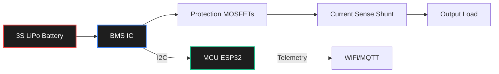

# Project: Custom 3S LiPo Battery Management System (BMS)

**Difficulty:** 🟦 Intermediate  
**Skills:** PCB Design, Power Electronics, MCU (ESP32/STM32), I2C  
**Estimated Time:** 15–25 hours  
**BOM Cost:** ~$30–$50

---

## What You'll Build

A complete Battery Management System (BMS) for a 3-cell (11.1V) Lithium Polymer battery pack. It will monitor individual cell voltages, balance the cells during charging, measure current draw, and cut off power in case of a short circuit or over-discharge. You will also include an MCU to transmit telemetry over WiFi/Bluetooth or UART.

## Why This Matters

Robots need power. Relying on off-the-shelf BMS modules is fine, but building your own teaches you critical safety, analog sensing, and high-current PCB layout—skills essential for any robotics hardware engineer.

## Architecture



1. **Cell Monitoring:** A dedicated BMS IC (like the TI BQ76920 or a generic alternative) to measure cell voltages.
2. **Protection MOSFETs:** High-current N-Channel MOSFETs on the low side (or high side with a charge pump) to disconnect the battery.
3. **Current Sense:** A shunt resistor (e.g., 1mΩ) with a current sense amplifier (like the INA219).
4. **Balancing Circuit:** Bleed resistors and small FETs to discharge high cells.
5. **Brain:** An ESP32-C3 or STM32 to read the data via I2C and enforce software limits, as well as broadcast telemetry.

## Step 1: Schematic Design (KiCad)

- **Power Path:** Route the battery negative terminal through the current sense shunt and the protection MOSFETs.
- **BMS IC Setup:** Follow the reference design for the chosen BMS IC. Ensure appropriate filtering capacitors on the cell voltage inputs.
- **Balancing:** Implement passive balancing. Calculate the bleed resistor: $R = 4.2V / 50mA \approx 84\Omega$. Use 100Ω resistors rated for at least 0.25W.
- **MCU Integration:** Add an LDO (e.g., 3.3V) powered from the full battery voltage to run your MCU. Connect the MCU to the BMS IC via I2C.

## Step 2: PCB Layout (Critical!)

High current layout requires specific rules:
- **Trace Width:** Use a PCB calculator. A trace carrying 20A needs to be very wide, or better yet, use a large copper polygon pour.
- **Thermal Relief:** Avoid thermal reliefs on high-current pads to minimize resistance.
- **Current Sense Routing:** Use Kelvin connections (differential pair routing) from the shunt resistor to the amplifier to avoid measuring trace resistance.
- **Isolation:** Keep the noisy power path away from the sensitive analog and I2C lines.

## Step 3: Firmware

Write C++ code for your MCU to:
1. Initialize the BMS IC over I2C.
2. Read the total voltage, current, and individual cell voltages at 10Hz.
3. Calculate State of Charge (SoC) using simple Coulomb counting or a voltage lookup table.
4. Broadcast data via MQTT (if using ESP32) or UART.

```cpp
// Example pseudocode for reading cell voltages
void loop() {
    float cell1 = bms.getCellVoltage(1);
    float cell2 = bms.getCellVoltage(2);
    float cell3 = bms.getCellVoltage(3);
    
    if (cell1 > 4.25 || cell2 > 4.25 || cell3 > 4.25) {
        bms.triggerOvervoltageProtection();
    }
    
    if (cell1 < 3.2 || cell2 < 3.2 || cell3 < 3.2) {
        bms.triggerUndervoltageProtection(); // Disconnect load!
    }
    
    // Publish telemetry
    publishTelemetry(cell1, cell2, cell3);
    delay(100);
}
```

## Step 4: Testing & Safety

**WARNING: Lithium batteries hold enormous energy. A short circuit can cause a fire.**
1. Test your PCB *without* a real battery first. Use a programmable power supply to simulate cell voltages using a resistor divider network.
2. Verify that the protection MOSFETs turn off when an over-voltage or under-voltage condition is simulated.
3. Once verified, connect a small, safe battery (or highly discharged LiPo) outside or in a fire-safe area for the first real load test.

## Extensions
- Add a tiny OLED screen to display battery percentage.
- Upgrade to an active balancing architecture using capacitors or inductors.
- Add an XT60 connector directly to the PCB footprint.
