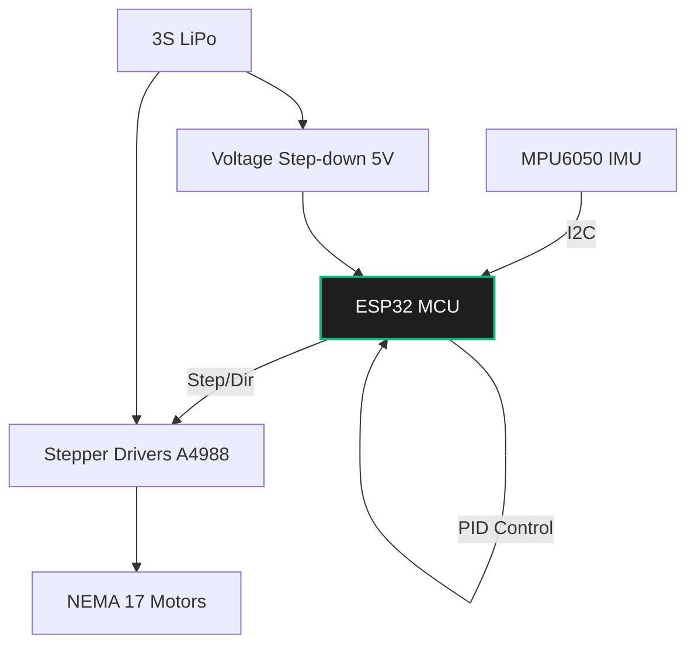

# Project: Self-Balancing Robot

**Difficulty:** 🟦 Intermediate  
**Skills:** Control Theory (PID), Sensor Fusion, MCU Programming  
**Estimated Time:** 10–20 hours  
**BOM Cost:** ~$50–$80

---

## What You'll Build

A two-wheeled inverted pendulum robot that balances itself dynamically. You will use an IMU to measure the tilt angle, run a control loop, and drive stepper motors to keep the robot upright.

## Why This Matters

The inverted pendulum is the "Hello World" of control theory. It forces you to deal with sensor noise, real-time control loops, and physical dynamics. The math and concepts used here apply directly to advanced robots like Boston Dynamics' Atlas or Segways.

## Hardware Required

- **MCU:** ESP32 or Arduino Nano (ESP32 preferred for speed and WiFi telemetry).
- **IMU:** MPU6050 (Accelerometer + Gyroscope).
- **Motors:** 2x NEMA 17 Stepper motors (steppers are excellent for this because they offer precise velocity control at low speeds, unlike cheap DC motors).
- **Motor Drivers:** 2x A4988 or TMC2209 stepper drivers.
- **Frame:** 3D printed chassis, laser-cut acrylic, or even cardboard and hot glue.
- **Power:** 3S LiPo battery (11.1V).

## System Architecture



## Step 1: Sensor Fusion (The Angle)

You cannot balance without knowing exactly how far you are leaning. 
- The **Accelerometer** measures gravity, giving an absolute angle, but it is highly susceptible to vibration and lateral movement.
- The **Gyroscope** measures angular velocity. Integrating it gives a smooth angle, but it drifts over time.

**Solution:** Implement a Complementary Filter.

```cpp
// Runs in a tight loop (e.g., 200Hz or 5ms dt)
float alpha = 0.98; // Trust the gyro mostly, slowly pull towards accel
float gyro_rate = readGyro(); // degrees per second
float accel_angle = calculateAngleFromAccel(); 

// Complementary filter formula
angle = alpha * (angle + gyro_rate * dt) + (1.0 - alpha) * accel_angle;
```

## Step 2: The PID Controller

The PID controller calculates how fast the wheels need to move to correct the tilt.

- **Proportional (P):** Reacts to the current error (tilt angle).
- **Integral (I):** Accumulates error over time (helps if the robot is slightly off-balance due to weight distribution).
- **Derivative (D):** Reacts to the rate of change of the angle (adds damping to prevent oscillation).

```cpp
float target_angle = 0.0; // Perfectly upright
float error = target_angle - current_angle;

integral += error * dt;
float derivative = (error - previous_error) / dt;
previous_error = error;

// Calculate required motor speed
float motor_speed = (Kp * error) + (Ki * integral) + (Kd * derivative);

setMotors(motor_speed); // Send pulses to stepper drivers
```

## Step 3: Stepper Motor Control

Steppers require pulses to move. To make the robot balance smoothly, you need to generate pulses at a highly precise, variable frequency based on the `motor_speed` calculated by the PID.

Use a hardware timer interrupt on the ESP32 to generate the step pulses independently of the main loop.

## Step 4: Tuning the PID

Tuning is the hardest part. The robot must be suspended or caught during this process.

1. Set $K_i$ and $K_d$ to 0. Increase $K_p$ until the robot starts oscillating back and forth rapidly.
2. Increase $K_d$ to dampen the oscillations. The robot should resist being pushed and try to stay flat.
3. If the robot tends to drift in one direction, add a small amount of $K_i$.

## Extensions

- **Remote Control:** Use the ESP32's Bluetooth or WiFi to send forward/backward speed commands. You do this by altering the `target_angle` slightly (e.g., tilting the robot forward makes it drive forward to catch itself).
- **LQR Control:** Upgrade from PID to a Linear Quadratic Regulator (LQR) using a state-space model for more robust balancing.
