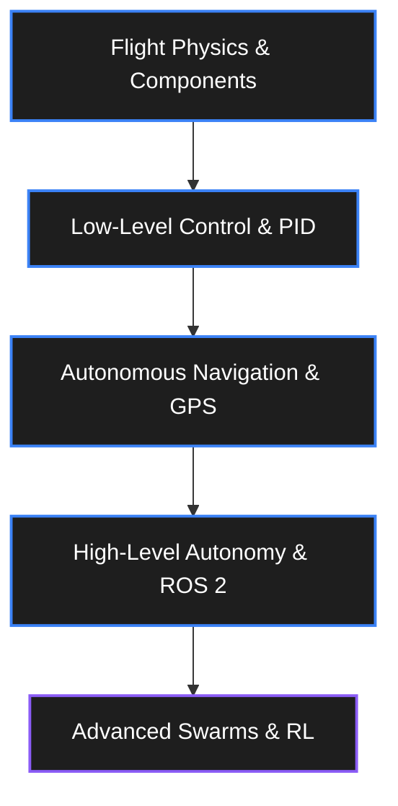

# Drone / UAV Engineer Roadmap

> From basic flight physics to autonomous swarms and computer vision.
> Estimated time: 6–18 months.

## Stage 1: Flight Physics & Components (Month 1-2)

Before writing code, you need to understand how multirotors fly.

### Aerodynamics & Physics
- [ ] Thrust, drag, weight, and lift.
- [ ] How a quadcopter moves (Pitch, Roll, Yaw, Throttle) by varying motor speeds.
- [ ] Center of Gravity (CoG) and moment of inertia.

### Hardware Components
- [ ] **Brushless DC Motors (BLDC)**: KV ratings, stator sizes (e.g., 2207 2400KV).
- [ ] **ESCs (Electronic Speed Controllers)**: Protocols (PWM, DShot), BLHeli firmware.
- [ ] **Propellers**: Pitch and diameter (e.g., 5045 props).
- [ ] **Batteries**: LiPo chemistry, C-ratings, internal resistance.
- [ ] **Flight Controllers (FC)**: STM32 processors (F4/F7/H7), IMUs (gyro + accel).

**Milestone:** Build a 5-inch FPV quadcopter from scratch, solder the components, and configure it in Betaflight to fly line-of-sight.

## Stage 2: Low-Level Flight Control (Month 3-5)

Understanding what happens inside the flight controller loop.

### Control Theory for Flight
- [ ] **PID Controllers**: Tuning P, I, and D for pitch, roll, and yaw.
- [ ] **Feedforward**: Anticipating stick inputs to reduce delay.
- [ ] **Filters**: Low-pass filters, notch filters, RPM filtering to handle frame resonance and motor noise.

### Sensor Fusion
- [ ] Reading raw IMU data (accelerometer + gyroscope).
- [ ] **Complementary Filter** and **Kalman Filter** to estimate orientation (attitude).
- [ ] Quaternions vs. Euler angles (and why gimbal lock is bad).

**Milestone:** Write a simple flight controller on an Arduino/ESP32. Read an MPU6050, run a PID loop, and output PWM to motors to stabilize a 1D pendulum or a small drone frame.

## Stage 3: Autonomous Navigation (Month 6-9)

Moving from manual control to GPS-guided autonomy.

### Software Stacks
- [ ] **ArduPilot**: The industry standard for autonomous vehicles (C++).
- [ ] **PX4**: Highly modular, great for research and ROS integration (C++).

### Sensors for Autonomy
- [ ] **GPS / GNSS**: NMEA parsing, RTK (Real-Time Kinematic) for cm-level accuracy.
- [ ] **Magnetometer (Compass)**: Calibration, dealing with electromagnetic interference.
- [ ] **Barometer**: Altitude estimation.
- [ ] **Optical Flow & LiDAR**: Position hold without GPS.

### Mission Planning
- [ ] MAVLink protocol: How ground stations talk to drones.
- [ ] QGroundControl and Mission Planner software.

**Milestone:** Configure a drone with PX4/ArduPilot and a GPS. Execute a fully autonomous waypoint mission including auto-takeoff and auto-landing.

## Stage 4: High-Level Autonomy & ROS (Month 10-14)

Adding a companion computer (like a Raspberry Pi or Jetson Nano) to handle advanced logic.

### Companion Computers & Middleware
- [ ] Connecting FC to Companion Computer via UART/Telemetry.
- [ ] **ROS 2 (Robot Operating System)**.
- [ ] **MAVROS / micro-ROS**: Bridging MAVLink to ROS topics.

### Computer Vision
- [ ] OpenCV basics.
- [ ] Visual Odometry (VIO): Estimating position using a camera and IMU (e.g., Intel RealSense T265 or VINS-Fusion).
- [ ] Object tracking and detection (YOLO).

**Milestone:** Use ROS 2 on a companion computer to command the drone to track and follow a specific colored object (e.g., a red ball) using a camera, sending velocity commands to the flight controller.

## Stage 5: Advanced Swarms & Reinforcement Learning (Month 15+)

The cutting edge of aerial robotics.

### Advanced Topics
- [ ] **Multi-Agent Systems**: Swarm coordination, collision avoidance between drones.
- [ ] **Reinforcement Learning**: Training flight policies in simulation (Isaac Gym) for aggressive maneuvers or landing on moving targets.
- [ ] **Sim-to-Real**: Transferring policies learned in Gazebo/AirSim to the real world.

---

## Resources

- **Books:** *Small Unmanned Aircraft: Theory and Practice* by Randal W. Beard
- **Simulators:** 
  - [Gazebo](https://gazebosim.org/) (Standard for ROS)
  - [AirSim / Colosseum](https://github.com/CodexLabsLLC/Colosseum) (Unreal Engine based)
- **Codebases to Study:**
  - [Betaflight](https://github.com/betaflight/betaflight)
  - [PX4 Autopilot](https://github.com/PX4/PX4-Autopilot)
