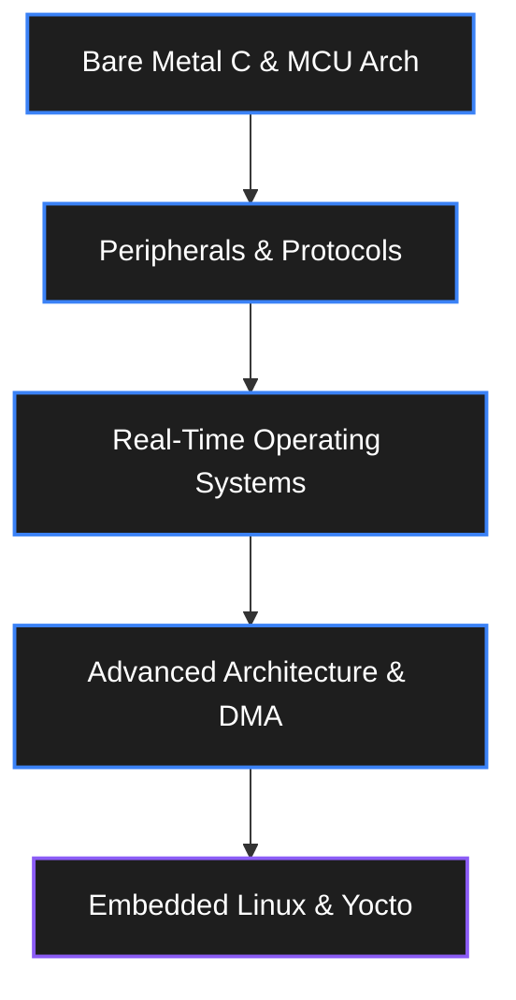

# Embedded Systems Engineer Roadmap

> From blinking an LED on an Arduino to writing Linux kernel modules for an ARM Cortex-A processor. 
> Estimated time: 6–12 months.

## Stage 1: The Bare Metal Basics (Month 1-2)

**Why start here?** You need to understand what the C code is actually doing to the hardware before you add layers of abstraction like RTOS or Linux.

### C Programming for Embedded
- [ ] Bitwise operations (`&`, `|`, `^`, `~`, `<<`, `>>`)
- [ ] Pointers, pointer arithmetic, and function pointers
- [ ] `volatile` and `const` keywords
- [ ] Structs, unions, and bit-fields
- [ ] Preprocessor directives (`#define`, `#ifdef`, macros)

### Microcontroller Architecture (ARM Cortex-M)
- [ ] Registers and memory-mapped I/O
- [ ] The boot process (Reset handler, Vector table)
- [ ] Clock trees (PLLs, oscillators)
- [ ] Interrupts (NVIC, ISRs, priority)
- [ ] Watchdog Timers (WDT)

**Milestone Project:** Write a bare-metal program (no HAL, just register manipulation) on an STM32 or RP2040 that blinks an LED using a hardware timer interrupt.

## Stage 2: Peripherals & Protocols (Month 3-4)

Learn how to talk to the outside world. 

### Core Peripherals
- [ ] **GPIO**: Input/Output, pull-up/pull-down, open-drain vs push-pull.
- [ ] **ADC / DAC**: Resolution, sample rate, DMA integration.
- [ ] **PWM**: Timers, duty cycle, motor control.

### Communication Protocols
- [ ] **UART**: Baud rate, parity, stop bits, RS-232 vs TTL.
- [ ] **I2C**: Master/slave, clock stretching, addressing, pull-up resistors.
- [ ] **SPI**: CPOL/CPHA modes, chip select, high-speed data transfer.
- [ ] **CAN Bus**: Differential signaling, arbitration, CAN frames (essential for robotics).

**Milestone Project:** Interface an MPU6050 (I2C) and an SD Card (SPI) to your MCU. Log the IMU data to the SD card at 100Hz.

## Stage 3: Real-Time Operating Systems (RTOS) (Month 5-6)

When bare-metal `while(1)` loops and interrupts become too messy, you need an RTOS. **FreeRTOS** is the industry standard.

### Core Concepts
- [ ] Task scheduling (preemptive vs cooperative)
- [ ] Context switching and tick interrupts
- [ ] Stack size and heap management
- [ ] Inter-Task Communication (IPC):
  - [ ] Queues (passing data safely)
  - [ ] Semaphores (signaling events)
  - [ ] Mutexes (protecting shared resources)
- [ ] Priority inversion and deadlocks

**Milestone Project:** Build a multi-tasking system. Task 1 reads sensors at 50Hz. Task 2 controls a motor based on sensor data. Task 3 handles a UART command line interface. Use queues to pass data safely.

## Stage 4: Advanced Architecture & Optimization (Month 7-8)

### DMA (Direct Memory Access)
- [ ] Understand how DMA offloads work from the CPU.
- [ ] Memory-to-memory, Peripheral-to-memory transfers.
- [ ] Circular buffers and double-buffering.

### Power Management
- [ ] Sleep modes (Sleep, Deep Sleep, Standby)
- [ ] RTC (Real-Time Clock) wakeups.
- [ ] Optimizing clock speeds dynamically.

### Tools & Debugging
- [ ] Using an Oscilloscope and Logic Analyzer.
- [ ] JTAG / SWD debugging (GDB, OpenOCD).
- [ ] Profiling execution time.

## Stage 5: Embedded Linux (Month 9-12)

Moving from microcontrollers (Cortex-M) to microprocessors (Cortex-A) like the Raspberry Pi or BeagleBone.

### Linux Fundamentals
- [ ] The Linux boot process (U-Boot, Kernel, Init).
- [ ] File systems (ext4, FAT, rootfs).
- [ ] Bash scripting and the command line.

### System Building
- [ ] **Buildroot**: Creating minimal Linux images.
- [ ] **Yocto Project**: The industry standard for custom Linux distros.
- [ ] Device Trees (DTS/DTB) to describe hardware to the kernel.

### Application & Kernel
- [ ] POSIX threads (pthreads) and Linux IPC (sockets, pipes, shared memory).
- [ ] Writing a basic Linux Kernel Module (LKM).
- [ ] Cross-compiling toolchains (GCC for ARM).

**Milestone Project:** Build a custom Yocto Linux image for a Raspberry Pi. Write a user-space C++ application that reads a sensor via I2C and serves the data over a lightweight web server.

---

## Resources

- **Books:** 
  - *Making Embedded Systems* by Elecia White
  - *Mastering the FreeRTOS Real Time Kernel* (Free PDF)
- **Courses:** 
  - [FastBit Embedded Brain Academy (Udemy)](https://www.udemy.com/user/kiran-nayak-2/) - Excellent bare-metal and RTOS courses.
  - [Bootlin Embedded Linux Training](https://bootlin.com/training/embedded-linux/) - Free high-quality slides and labs.
