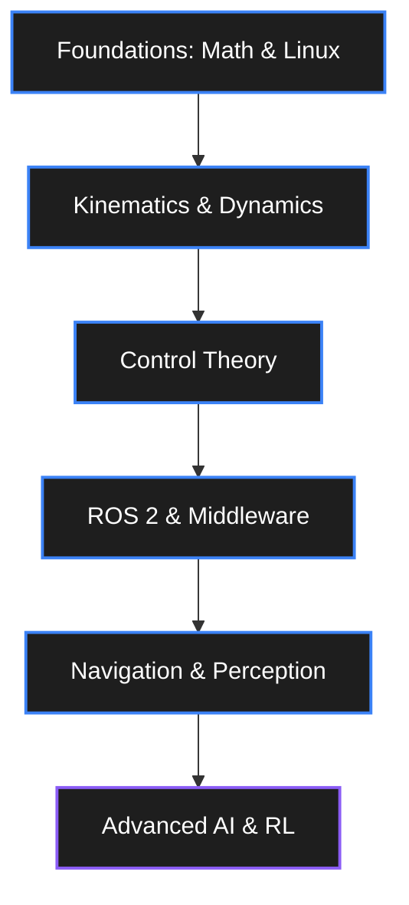

# Robotics Engineer Roadmap

> From controlling a servo to deploying a full autonomous robot. Estimated time: 12–24 months.



## Prerequisites

Before starting this roadmap, you should be comfortable with:
- Python (intermediate) — numpy, matplotlib, scipy
- Linear algebra: vectors, matrices, transformations
- Basic calculus: derivatives, integrals
- Basic physics: kinematics, Newton's laws

If you're weak in any of these, patch them first. The math is the actual skill.

---

## Stage 0: Physical Intuition (Weeks 1–2)

**Do this before any theory:**
1. Buy a cheap robot arm kit ($30) and assemble it — feel how joints work
2. Drive an RC car — understand kinematics intuitively
3. Watch 20 minutes of Boston Dynamics videos — understand what "hard" looks like
4. Watch 20 minutes of human factory workers — understand why robots fail

**Key insight:** Robotics is not just programming. It's the intersection of mechanical design, electronics, control theory, and software. You must be comfortable in all four.

---

## Stage 1: Foundations (Months 1–3)

### Mathematics for Robotics

**Rigid Body Transforms (essential):**
```python
import numpy as np

# Rotation matrices
def Rx(theta):
    c, s = np.cos(theta), np.sin(theta)
    return np.array([[1,0,0],[0,c,-s],[0,s,c]])

def Ry(theta):
    c, s = np.cos(theta), np.sin(theta)
    return np.array([[c,0,s],[0,1,0],[-s,0,c]])

def Rz(theta):
    c, s = np.cos(theta), np.sin(theta)
    return np.array([[c,-s,0],[s,c,0],[0,0,1]])

# Homogeneous transform
def T(R, p):
    T = np.eye(4)
    T[:3,:3] = R
    T[:3,3] = p
    return T

# Compose transforms: world → robot → tool
T_world_tool = T_world_robot @ T_robot_tool
```

**Topics to cover:**
- [ ] Rotation matrices, Euler angles, quaternions — know all three
- [ ] Homogeneous transforms — SE(3) intuition
- [ ] Twist and wrench — velocities and forces in 6D
- [ ] Screw theory basics (for Modern Robotics approach)
- [ ] Jacobian matrix — velocity kinematics
- [ ] Pseudo-inverse for redundant robots

**Resources:**
- [Modern Robotics](http://modernrobotics.org/) + [Coursera course](https://www.coursera.org/specializations/modernrobotics) — Do this
- 3Blue1Brown — Essence of Linear Algebra (YouTube)

### Control Theory

**PID (start here):**
```python
class PID:
    def __init__(self, kp, ki, kd, dt):
        self.kp, self.ki, self.kd, self.dt = kp, ki, kd, dt
        self.integral = 0
        self.prev_error = 0

    def update(self, setpoint, measurement):
        error = setpoint - measurement
        self.integral += error * self.dt
        derivative = (error - self.prev_error) / self.dt
        self.prev_error = error
        return self.kp*error + self.ki*self.integral + self.kd*derivative
```

**Topics:**
- [ ] Open loop vs closed loop control
- [ ] PID: P, I, D terms — physical intuition for each
- [ ] Ziegler-Nichols tuning method
- [ ] Cascade control (inner + outer loops)
- [ ] State-space representation: ẋ = Ax + Bu, y = Cx + Du
- [ ] LQR (Linear Quadratic Regulator) — optimal state feedback
- [ ] Pole placement, stability analysis
- [ ] Kalman Filter — optimal state estimation

**Resources:**
- [MATLAB Control Systems (YouTube)](https://www.youtube.com/playlist?list=PLn8PRpmsu08q8CE0pbZ-cSrMm_WYJfVGd)
- [Brian Douglas Control Theory](https://www.youtube.com/@BrianBDouglas) — Best control theory channel
- [Steve Brunton Data-Driven Control](https://www.youtube.com/@Eigensteve)

---

## Stage 2: Robot Kinematics & Dynamics (Months 2–4)

### Forward Kinematics

```python
# Denavit-Hartenberg convention
# Each joint: [theta, d, a, alpha]
# T_i = Tz(theta) * Tz(d) * Tx(a) * Rx(alpha)

def dh_matrix(theta, d, a, alpha):
    ct, st = np.cos(theta), np.sin(theta)
    ca, sa = np.cos(alpha), np.sin(alpha)
    return np.array([
        [ct, -st*ca,  st*sa, a*ct],
        [st,  ct*ca, -ct*sa, a*st],
        [0,   sa,     ca,    d   ],
        [0,   0,      0,     1   ]
    ])

# 6R robot: compose all 6 transforms
def forward_kinematics(joint_angles, dh_params):
    T = np.eye(4)
    for i, (theta_offset, d, a, alpha) in enumerate(dh_params):
        T = T @ dh_matrix(joint_angles[i] + theta_offset, d, a, alpha)
    return T
```

### Inverse Kinematics

```python
# Numerical IK via Jacobian pseudo-inverse
def inverse_kinematics(target_pose, q_init, max_iter=1000, tol=1e-4):
    q = q_init.copy()
    for _ in range(max_iter):
        T_curr = forward_kinematics(q, dh_params)
        error = compute_pose_error(target_pose, T_curr)  # 6D error
        if np.linalg.norm(error) < tol:
            break
        J = compute_jacobian(q, dh_params)
        J_pinv = np.linalg.pinv(J)  # Moore-Penrose pseudo-inverse
        dq = J_pinv @ error
        q += 0.1 * dq  # step size
    return q
```

**Topics:**
- [ ] DH parameters — assign to any serial robot
- [ ] Workspace analysis: reachable vs dexterous
- [ ] Singularities — understand geometrically
- [ ] Redundancy resolution
- [ ] Closed-form IK for 6R robots (Pieper's solution)

### Dynamics

**Equations of Motion:**
```
M(q)q̈ + C(q,q̇)q̇ + G(q) = τ + J^T(q)F_ext

Where:
  M(q)    = inertia matrix (n×n, always positive definite)
  C(q,q̇) = Coriolis and centripetal matrix
  G(q)    = gravity vector
  τ       = joint torques (control input)
  J^T F   = external forces mapped to joint space
```

**Topics:**
- [ ] Lagrangian vs Newton-Euler formulation
- [ ] Recursive Newton-Euler algorithm (efficient O(n))
- [ ] Gravity compensation
- [ ] Feed-forward + PD control for fast motion
- [ ] Impedance control: F = K(x_d - x) + D(ẋ_d - ẋ)

**Library:** [Pinocchio](https://github.com/stack-of-tasks/pinocchio) — compute dynamics for any URDF

---

## Stage 3: ROS 2 (Months 3–6)

**Learn in this order:**
1. ROS 2 concepts: nodes, topics, services, actions, parameters
2. Write your first publisher/subscriber in Python
3. Write a service server/client
4. Use RViz2 for visualization
5. TF2 — coordinate frame transforms (critical for robotics)
6. URDF / Xacro — robot description language
7. Launch files — manage complex systems
8. ros2_control — hardware abstraction layer
9. Nav2 — complete autonomous navigation
10. MoveIt 2 — robot manipulation planning

```bash
# Standard dev workflow
mkdir -p ~/ros2_ws/src && cd ~/ros2_ws/src
ros2 pkg create --build-type ament_python my_robot_pkg
cd ~/ros2_ws && colcon build
source install/setup.bash

# Test communication
ros2 run demo_nodes_py listener &
ros2 run demo_nodes_py talker
```

**Complete these tutorials (in order):**
- [Official ROS 2 Tutorials](https://docs.ros.org/en/humble/Tutorials.html) — Don't skip any
- [Robotics Backend ROS 2 Course](https://roboticsbackend.com/category/ros2/) — Excellent supplements
- [Articulated Robotics YouTube](https://www.youtube.com/@ArticulatedRobotics) — Visual + practical

---

## Stage 4: Sensors & Perception (Months 4–7)

### LiDAR Processing

```python
import open3d as o3d
import numpy as np

# Load and process point cloud
pcd = o3d.io.read_point_cloud("scan.pcd")

# Voxel downsampling
pcd_down = pcd.voxel_down_sample(voxel_size=0.05)

# Normal estimation
pcd_down.estimate_normals(
    search_param=o3d.geometry.KDTreeSearchParamHybrid(radius=0.1, max_nn=30))

# ICP registration (scan matching)
result = o3d.pipelines.registration.registration_icp(
    source, target, max_correspondence_distance=0.05,
    estimation_method=o3d.pipelines.registration.TransformationEstimationPointToPoint())
print(result.transformation)  # 4×4 transform
```

### Computer Vision for Robotics

```python
import cv2
import numpy as np

# Detect ArUco markers (fiducial markers for pose estimation)
aruco_dict = cv2.aruco.getPredefinedDictionary(cv2.aruco.DICT_4X4_50)
detector = cv2.aruco.ArucoDetector(aruco_dict)
corners, ids, _ = detector.detectMarkers(gray_image)

# Estimate pose from corners
rvec, tvec, _ = cv2.aruco.estimatePoseSingleMarkers(
    corners, marker_size, camera_matrix, dist_coeffs)
# tvec = translation (position), rvec = rotation (Rodrigues vector)

# Camera calibration
ret, mtx, dist, rvecs, tvecs = cv2.calibrateCamera(
    objpoints, imgpoints, gray.shape[::-1], None, None)
```

**Topics:**
- [ ] Camera models: pinhole, distortion (radial, tangential)
- [ ] Camera calibration: checkerboard method
- [ ] Stereo vision: epipolar geometry, disparity maps
- [ ] Depth estimation from structured light, ToF, stereo
- [ ] Feature detection: SIFT, ORB, SuperPoint
- [ ] Object detection: YOLO, DETR (run on edge hardware)
- [ ] Pose estimation: PnP, EPnP, keypoint matching

---

## Stage 5: SLAM & Navigation (Months 6–10)

### SLAM Theory

```
The SLAM Problem:
  Given: sensor data z_{1:t}, control inputs u_{1:t}
  Find:  map m AND robot poses x_{1:t}
  
  SLAM is a chicken-and-egg problem:
  - To build a map, you need to know where you are
  - To know where you are, you need a map
  → Solve jointly with probabilistic estimation
  
Particle Filter SLAM (FastSLAM):
  - Represent pose belief as set of particles
  - Each particle has own map estimate
  - Resample based on sensor likelihood

Graph-Based SLAM:
  - Pose graph: nodes = robot poses, edges = constraints
  - Add edges from sensor matching (ICP, scan matching)
  - Loop closure: recognize previously visited places
  - Optimize: minimize total constraint error (g2o, GTSAM)
```

**Practice:**
- [ ] Run gmapping in Gazebo with TurtleBot
- [ ] Run Cartographer with a real RPLidar
- [ ] Run RTAB-Map with RGB-D camera
- [ ] Run FAST-LIO2 with 3D LiDAR (if available)

### Autonomous Navigation

```python
# Nav2 Python client — send navigation goal
import rclpy
from nav2_simple_commander.robot_navigator import BasicNavigator
from geometry_msgs.msg import PoseStamped

navigator = BasicNavigator()

goal_pose = PoseStamped()
goal_pose.header.frame_id = 'map'
goal_pose.pose.position.x = 2.0
goal_pose.pose.position.y = 1.5
goal_pose.pose.orientation.w = 1.0

navigator.goToPose(goal_pose)

while not navigator.isTaskComplete():
    feedback = navigator.getFeedback()
    print(f'Distance remaining: {feedback.distance_remaining:.2f}m')
```

---

## Stage 6: Robot Arms & Manipulation (Months 8–14)

### MoveIt 2

```python
from moveit.planning import MoveItPy
from moveit.core.robot_state import RobotState

moveit = MoveItPy(node_name="my_moveit")
panda_arm = moveit.get_planning_component("panda_arm")

# Plan to joint state
robot_state = RobotState(moveit.get_robot_model())
robot_state.set_to_random_positions()
panda_arm.set_goal_state(robot_state=robot_state)
plan = panda_arm.plan()

# Plan to Cartesian pose
from geometry_msgs.msg import PoseStamped
target = PoseStamped()
target.pose.position.x = 0.5
panda_arm.set_goal_state(pose_stamped_msg=target, pose_link="panda_link8")
plan = panda_arm.plan()
if plan:
    moveit.execute(plan, controllers=[])
```

**Topics:**
- [ ] Motion planning: OMPL planners, constraints
- [ ] Collision checking: FCL, OctoMap
- [ ] Grasping: grasp pose estimation, GraspIt!
- [ ] Force control: impedance, admittance, hybrid
- [ ] Assembly tasks: peg-in-hole, insertion strategies

---

## Stage 7: Advanced Control (Months 10–18)

### Model Predictive Control (MPC)

```python
# MPC pseudocode using CVXPY
import cvxpy as cp

def mpc_step(x0, N=20, Q=np.eye(4), R=np.eye(2)):
    x = cp.Variable((4, N+1))
    u = cp.Variable((2, N))
    
    cost = 0
    constraints = [x[:,0] == x0]
    
    for t in range(N):
        cost += cp.quad_form(x[:,t] - x_ref, Q) + cp.quad_form(u[:,t], R)
        constraints += [x[:,t+1] == A @ x[:,t] + B @ u[:,t]]
        constraints += [cp.norm(u[:,t], 'inf') <= u_max]
    
    prob = cp.Problem(cp.Minimize(cost), constraints)
    prob.solve(solver=cp.OSQP)
    return u[:,0].value  # apply only first action (receding horizon)
```

### Whole-Body Control

```python
# Task-space QP controller (simplified)
# Minimize: ||J*q̈ - ẍ_des||² + regularization
# Subject to: dynamics, joint limits, contact forces

# Using qpsolvers or CVXPY
from qpsolvers import solve_qp

# Build H (quadratic cost), f (linear cost), A (equalities), b, G (inequalities), h
q_ddot = solve_qp(H, f, G, h, A, b, solver='osqp')
```

---

## Stage 8: Physical AI (Months 18–24)

See [Physical AI Roadmap](physical-ai.md) for this stage.

Summary of what to study:
- Reinforcement learning basics (Sutton & Barto book — free online)
- Deep RL: PPO, SAC, TD3
- Sim-to-real transfer techniques
- Imitation learning: behavior cloning, DAgger, ACT
- Foundation models for robotics: RT-2, Diffusion Policy

---

## Project Progression

Build these in order. Each one uses skills from previous stages.

1. ⬜ Line follower with PID control
2. ⬜ Self-balancing robot (inverted pendulum)
3. 🟦 2D mapping robot with ROS 2 + RPLidar
4. 🟦 3-DOF robot arm with IK (servo-based)
5. 🟦 Autonomous navigation with Nav2
6. 🟥 6-DOF arm with MoveIt 2 + grasp planning
7. 🟥 Sim-to-real locomotion (quadruped)
8. 🟥 Bimanual manipulation with imitation learning
